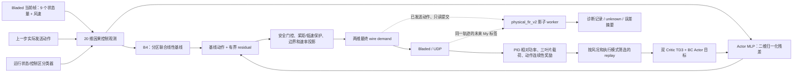

# RL 控制模型与物理载荷影子模型说明

**文档日期：2026-10-22**  
**当前活动项目发行版：`WT15_STATE20_RL_20261023_R2`。** 该版将 state20 / 状态条件 Delta-B4 / BC v3 / TD3+BC 与只读 `physical_fir_v2` shadow 统一为一个 rounds-configurable 23-wind route；R1 是不可变历史归档。
**结论级别：模型与配置说明，不等于控制策略验收、载荷安全证明或生产保护授权。**

本文面向研发、复核和交接使用：先说明“每个模型负责什么”，再列输入维度、网络层、训练参数、动作边界、物理影子误差与当前实验状态。数值以当前配置、冻结工件及小型运行摘要为依据；历史配置只用于版本对照，不当作当前值。

## 1. 一页结论

当前控制不是“一个神经网络直接输出最终扭矩和桨距”，而是一个**分层的残差控制系统**：

1. **状态识别**：从实时风速、转速、功率、桨距和时间历史，因果地识别启动/停机、额定以下、过渡区、额定以上等区域。
2. **B4 基线**：每个控制区各有一个小型联合线性模型，依据当前状态和上一步实际动作预测基线动作变化。
3. **BC v3 / Actor**：两个同结构的 MLP Actor 学习相对 B4 基线的二维残差；BC v3 提供初始策略，TD3 后续在线微调。
4. **安全控制器**：执行 OOD、低转速、桨距保护、绝对边界和动作速率投影。它有权把 Actor 残差抑制为零、修正动作或转入保护/基线模式。
5. **TD3+BC 学习器**：双 Critic 估计价值、延迟 Actor 更新，并在 Actor 目标中保留 BC 行为约束；训练数据按风况/执行模式管理。
6. **物理载荷影子**：把已成功发送的动作和现有传感器帧送到独立 worker，估计未来三片叶根 My；结果只记录，不改变 Actor、奖励、回放动作或真实控制。

最重要的边界：**Actor 输出是归一化 residual，不是物理扭矩；物理影子是发送后的诊断，不是发送前保护。** 影子模型的经验余量来自复用开发数据，不能保证未来 RL 轨迹不超过 PID 峰值。

## 2. 系统结构与数据流

虚线表示影子日志支路。影子没有通往动作合成器、reward 或 optimizer 的控制连线。主要源码入口为 [RL/train_rl.py](../RL/train_rl.py)、[RL/agents/td3.py](../RL/agents/td3.py)、[RL/utils/safe_residual_control.py](../RL/utils/safe_residual_control.py) 和 [RL/utils/physical_load_shadow.py](../RL/utils/physical_load_shadow.py)。

## 3. 当前活动版本与身份

R2 活动发行 ID、rounds-default profile/SHA、历史 R1 archive 和授权状态记录在 [R2 release manifest](../RL/configs/WT15_STATE20_RL_20261023_R2/release_manifest.json)。项目发行号不替代组件兼容版本：state20 是观测维度合同，BC v3、数据 v2、UDP queue-v2、physical_fir/D0-R v2 等仍保留原身份。

| 部件 | 当前版本/工件 | 用途与身份 |
|---|---|---|
| 当前项目发行 | [WT15_STATE20_RL_20261023_R2](../RL/configs/WT15_STATE20_RL_20261023_R2/README.md) | 唯一活动跨组件发行 ID；rounds-configurable，默认 4 轮，仍 blocked |
| 历史项目发行 | [WT15_STATE20_RL_20261022_R1](../RL/configs/WT15_STATE20_RL_20261022_R1/README.md) | 原 6-round SHA/manifest 只读归档，不是代码分支 |
| 数据合同 | `bladed_udp_19_si_my_v1` | 19 个 UDP 字段的 SI/My 数据合同；Actor 观测只取规定的 9 个状态量和平均风速 |
| 观测合同 | state20 | 10 个基础量 + 2 个上一步动作特征 + 8 个因果类别 one-hot |
| B4 基线 | [RL/data/region_aware_joint_baseline_state20_3_to_25_v3.json](../RL/data/region_aware_joint_baseline_state20_3_to_25_v3.json) | 23 个 PID raw 风况，状态分区的联合动作增量模型 |
| 状态/动作包络 | [RL/data/state_action_envelope_3_to_25_v1.json](../RL/data/state_action_envelope_3_to_25_v1.json) | 固定状态编码、区域阈值和 residual envelope；SHA-256 `043eb7c7…7395d3` |
| BC 初始策略 | [RL/BC_checkpoint/bladed_pid_b4_state20_residual_v3.pt](../RL/BC_checkpoint/bladed_pid_b4_state20_residual_v3.pt) | 当前 state20 BC warm-start；SHA-256 `ffeb4650…e509db80` |
| 控制指纹 | state20 resolved contract | `578179ea…1295ba24`；改变动作语义、边界、状态包络或依赖时须重新绑定 |
| 当前物理影子 | [R2 profile bundle](../RL/configs/WT15_STATE20_RL_20261023_R2/physical_load_shadow_bundle.json) | `physical_fir_v2`，只读；`nn_active=false`，不提供动作保护 |
| 当前 23wind physical profile | [R2 rounds-configurable profile](../RL/configs/WT15_STATE20_RL_20261023_R2/state20_physical_23wind_round600_training.json) | 默认 23 风况 × 4 轮 × 600 s、92 slots；同一 profile 支持配置 rounds；`authorized=false`，未启动 |
| R1 六轮归档 | [WT15_STATE20_RL_20261022_R1](../RL/configs/WT15_STATE20_RL_20261022_R1/state20_physical_23wind_6round_600s_training.json) | 原 SHA/receipt 保留，不再是活动分支；R2 receipt 不能用于 R1 |
| 历史 RUN_ID 证据 | [physical_23wind6_600s_20261016T155444Z_939992](../RL/configs/physical_23wind6_600s_20261016T155444Z_939992/train.json) | 旧候选身份；仅保留审计，不能作为当前 profile 配置或续跑入口 |

上述控制指纹和 SHA 是**文件/合同身份**，不能单独证明工程风文件、硬件时延或策略性能通过。当前活动 ID 为 `WT15_STATE20_RL_20261023_R2`，同一 23-wind profile 通过 rounds config 形成不同 schedule identity；R1 六轮材料只读归档。`candidate_v11`/`candidate_v12` 是更早历史候选。当前物理 shadow 配置不加载 NN，且没有 NN 权重可作为该配置的活动模型。

为便于审计，以下给出当前依赖的完整 SHA-256（不是前表的缩写）：

| 工件 | SHA-256 |
|---|---|
| BC v3 checkpoint | `ffeb465028cbdba644fe97744efaf9b0ebe6d84de2838296892e8d44e509db80` |
| B4 baseline | `882ff630846bf8e6ae7445090830902b413f9cf5574580a2ee46f192adc7cacc` |
| state/action envelope | `043eb7c7f9ce3e8f36df4a326588df5807232babe02b22aeae8754de2c7395d3` |
| BC residual dataset manifest | `2aeeb621f7d954e6923146d223ceae94d8b6e6befc7fc62c2a65b5df2f3acdd3` |
| 600 s paired PID reference | `de8cc59fd93c3af4f5be00c0184bd176a807095c1b421d3c23ae7c2c74cc82d2` |
| state20 resolved control fingerprint | `578179ea2f324e7522014a930c5df8497dec6d5d819c2703358548891295ba24` |
| physical shadow bundle | `38a21e7c0c81258e789704193063818c50dca903e615878a88a6a92a89722a17` |
| D0-R dynamic model canonical document | `c8286005ce23afc13490906461d80b87245d6bca72a10d2f7f71b53d41baad36` |

动态模型的 canonical document SHA 与具体 JSON 文件字节 SHA 是两种校验口径；最新物理 shadow run 记录的动态模型文件 SHA 为 `2259297992ae6000e1a7a1a72dc52892edcf068522141d3001b8167931ff850e`，不要把它与 canonical SHA 混用。

## 4. 输入、输出与维度

### 4.1 Actor 的 20 维观测

基础观测的 10 个数值依次为：

| 序号 | 字段 | 含义 |
|---:|---|---|
| 1 | `I_RotorAzimuth` | 转子方位角；离线和在线都折返到 $[0,2\pi)$ |
| 2 | `I_RotorSpeed` | 转子转速 |
| 3 | `I_YawError` | 偏航误差 |
| 4 | `I_ElectricalTorque` | 当前电磁转矩测量 |
| 5 | `I_GeneratorSpeed` | 发电机转速 |
| 6 | `I_RealPower` | 当前有功功率测量 |
| 7 | `I_PitchPosition1` | 叶片 1 的实测桨距/集体桨距代表量 |
| 8 | `I_NacelleForeAftAcceleration` | 机舱前后向加速度 |
| 9 | `I_NacelleSideSideAcceleration` | 机舱侧向加速度 |
| 10 | `I_AverageWindSpeed` | 平均风速扰动输入 |

追加维度：

- 11–12：上一步**实际发送**的 torque/pitch demand，按工程边界归一化到约 $[-1,1]$。
- 13–17：优化状态 one-hot：`startup_stopped`、`below_rated`、`transition`、`above_rated`、`negative_power_abnormal`。
- 18–20：控制区 one-hot：`below_rated`、`transition`、`above_rated`。

Actor 的输入维数为 $20$。这不是 RNN：策略网络每步读取当前 20 维向量，**不直接接收历史 My 序列、PID 峰值或物理影子预测**。历史依赖通过上一步动作、滤波风速、滞回分类状态，以及控制器保存的保护状态间接体现。字段定义见 [RL/utils/constants.py](../RL/utils/constants.py)、[RL/utils/operating_state.py](../RL/utils/operating_state.py) 和 [RL/utils/observation.py](../RL/utils/observation.py)。

状态分类使用因果 2 s 指数风速滤波、区域切换滞回和 1 s 确认时间：过渡区进入/退出风速为 11.8/11.2 m/s，额定以上进入/退出为 13.8/13.2 m/s；运行转子速度阈值 0.5 rad/s，停机阈值 0.4 rad/s；功率判据 100 kW，负功率异常阈值为 −1 kW。两套 one-hot 各表达不同概念：**优化状态**处理启停/异常，**控制区**选择 below/transition/above 的区域模型。

训练数据的 Actor/Critic 观测采用训练集统计量做 median/IQR 标准化；Actor 内再把标准化结果截到 $[-10,10]$。one-hot 也属于这 20 维观测，但语义仍是类别，而非新增传感器。

### 4.2 Actor 的二维动作是 residual

Actor 输出的两个维度不是 torque Nm、pitch rad，而是对 B4 基线的**归一化修正量**：

1. torque residual；
2. pitch residual。

设 $b_t$ 为 B4 预测的二维物理动作，$L(s_t)$ 为状态相关 residual envelope，$r_t$ 为 Actor 输出，则安全投影前的策略请求为

$$
 u_t^{\mathrm{req}} = b_t + r_t \odot L(s_t),\qquad
 r_t = 0.25\,\tanh(f_\theta(s_t))\in[-0.25,0.25]^2.
$$

工程边界为 torque $[0,21{,}586{,}451.33303]$ Nm、pitch $[0,0.43]$ rad。每个 20 ms 控制步的工程增量边界为 torque $\pm90{,}000$ Nm、pitch $\pm0.000698$ rad。状态包络的基础值如下：

| 优化状态 | torque residual limit | pitch residual limit | 说明 |
|---|---:|---:|---|
| startup/stopped | 0 Nm | 0 rad | 不让 Actor 在停机/启动阶段施加 residual |
| below-rated | 15,000 Nm | 0.00030 rad | 按滤波风速向过渡区平滑混合 |
| transition | 15,000 Nm | 0.00035 rad | 过渡区 |
| above-rated | 20,000 Nm | 0.00035 rad | 按滤波风速向额定以上平滑混合 |
| negative-power abnormal | 0 Nm | 0 rad | 异常状态不让 Actor 施加 residual |

由于 Actor 输出再乘 $0.25$，通常的策略增量上限约为：below/transition torque $\pm3.75$ kNm、above-rated $\pm5$ kNm；pitch 约 $\pm0.000075$ 至 $\pm0.0000875$ rad。保护动作、rate limit 和投影仍可能进一步改变实际发送量。**这些是策略局部修正范围，不是硬载荷安全界。**

当前配置的基线默认值为 $[20{,}309{,}163\ \mathrm{Nm},\ 0.06352876875\ \mathrm{rad}]$，但正常 B4 不是这个常数，而是下节的区域模型。

## 5. B4：状态分区的联合线性基线

### 5.1 做什么

B4 是“当前工况下合理的下一步 torque/pitch”基线。它不直接输出最终安全动作，也不是 TD3 Actor。当前 state20 工件使用 `joint_next_action_delta`：学习在已有动作上的联合增量，再经 action/rate 边界限制。

对每个控制区分别拟合一个 $6\rightarrow2$ 线性模型。输入为：

1. 因果滤波风速；
2. 转子速度；
3. 发电机速度；
4. 实功率；
5. 上一步实际 torque demand；
6. 上一步实际 pitch demand。

每项输入由训练均值/尺度标准化，输出两个 action delta。区域切换时用 hysteresis 状态机和 smoothstep 混合，避免 11.8/13.8 m/s 阈值附近基线突然跳变。最终动作再经过 residual controller 的边界与速率处理。

### 5.2 数据和参数

- 来源：[bladed-data-new/raw](../bladed-data-new/raw)，23 个风况 3–25；每条 30,001 行、共 690,023 行、约 690,000 个相邻转移。
- 监督信号来自 recorded PID torque/pitch demand 与上一步动作间的增量；文件合同标注为 `recorded_pid_demand`。
- 每个区域模型包含一个 $2$ 维 intercept 和 $6\times2$ 系数矩阵；共 3 个区域、每个模型同时输出 torque/pitch。
- B4 的 residual delta 被约束在每步 $\pm90$ kNm、$\pm0.000698$ rad 工程增量范围内，并再受状态包络和动作投影约束。
- B4 SHA-256：`882ff630…adc7cacc`，配置文件和完整元数据见上方链接。

**来源限制：** B4/BC 的标签来自历史 raw CSV 的 `O_*` 列并按 recorded PID demand 合同构造；CSV 列名和数据内容本身不能证明历史 DLL 的 demand/measurement 别名语义。当前 DLL 的 `O_*` 是 measurement alias；这一来源/时序问题仍需按已批准的工程与记录器证据界定，不应把离线 imitation 指标当作真实动作因果证明。

## 6. BC v3：行为克隆初始 Actor

### 6.1 数据标签

离线数据采用 B4-centered residual 合同，不是让网络从状态直接拟合绝对动作：

$$
 y_t^{BC}=0.25\;\operatorname{clip}\!\left(
 \frac{u_t^{PID,\,effective}-b_t^{B4}}{L(s_t)},-1,1\right).
$$

其中 $u_t^{PID,\,effective}$ 是按工程边界 clip 后的 recorded PID demand；$b_t^{B4}$ 是同一时刻状态下 B4 基线；$L(s_t)$ 是该状态的 torque/pitch residual limit。startup/stopped 和 negative-power state 的 $L(s_t)=0$，因此目标 residual 为零。训练 manifest 保留 raw demand、effective demand、target residual 等列，并记录逐风况 clipping audit。

### 6.2 训练设置与质量指标

BC Actor 与 TD3 Actor 使用相同 MLP：$20\rightarrow256\rightarrow256\rightarrow128\rightarrow2$。v3 预训练配置声明 seed 42、CPU、SmoothL1、batch 256、5,000 个 BC 更新、在 2,000/5,000 步保存检查点、冻结 Critic；指标每 100 步记录。当前 RL 启动配置则设置 `bc.steps=0`、不导出覆盖 checkpoint，表示**从冻结 v3 warm-start，不在每次在线训练开始时重做 BC**。配置见 [BC v3 预训练配置](../RL/configs/b4_residual_smoke/bc_pretrain_b4_state20_residual_600s_v3.json)。

| 数据角色 | 条件来源 | 行数 | 角色 |
|---|---|---:|---|
| BC train | `bladed-data-new/raw` 的 wind3–25 | 690,023 | 拟合 B4 residual imitation |
| BC validation | `bladed-data-new/raw_infer` 的 wind8、16、24 | 90,003 | 独立于训练工况文件的 teacher-forced 离线 holdout |

v3 val holdout 的 normalized torque/pitch residual MAE 约为 **0.05568 / 0.03585**。这两个数是输出 residual 尺度上的 teacher-forced 离线 MAE，不是 Nm/rad，不是闭环性能，也不是 shadow 精度。

## 7. 在线算法：TD3 + BC

### 7.1 Actor/Critic 网络与参数量

隐藏层宽度全部为 $[256,256,128]$，隐藏激活为 SiLU：

| 网络 | 输入 | 结构 | 输出 | 单个模块参数量 |
|---|---:|---|---:|---:|
| Actor | 20 | $20\rightarrow256\rightarrow256\rightarrow128$ | 2 维 residual，tanh 后乘 0.25 | 104,322 |
| Critic $Q_1/Q_2$ | 20 维状态 + 2 维 residual = 22 | $22\rightarrow256\rightarrow256\rightarrow128$ | 1 个标量 Q | 每个 104,705 |

一个 TD3 agent 保存 3 个 Actor 拷贝（训练 Actor、target Actor、实际执行 Actor）和 4 个 Critic 拷贝（$Q_1,Q_2,Q'_1,Q'_2$），总计约 **731,786 个网络参数**。其中训练时参与 optimizer 的是当前 Actor 和两个在线 Critic，共 **313,732 个参数**；target 和 execution 网络是状态副本，不单独训练。以上是全连接层权重/偏置计数，不含 optimizer 状态和观测归一化 buffers。

Actor 使用 median/IQR 标准化、输入 clip $[-10,10]$、输出 tanh×0.25。Critic 对状态使用相同 median/IQR 标准化并 clip；动作以 residual 标度拼到状态后输入 Critic。实际推理由独立 `actor_execution` 副本执行，网络参数非有限时拒绝发布新 Actor 参数。

### 7.2 TD3 的 Critic target 与 actor loss

双 Critic 的 target action 使用小幅 target-policy smoothing：

$$
\epsilon\sim\operatorname{clip}(\mathcal{N}(0,0.005^2),-0.01,0.01),\qquad
 a'=\operatorname{clip}(\pi_{\theta'}(s')+\epsilon,-0.25,0.25).
$$

$$
 y=r+0.999(1-d)\min\{Q'_1(s',a'),Q'_2(s',a')\},\qquad
 L_Q=\operatorname{SmoothL1}(Q(s,a),y).
$$

每个有效更新都训练两个 Critic；Actor 默认每 4 个 Critic 更新槽才尝试一次。Actor 目标由确定性策略梯度项和 BC 约束构成：

$$
 L_{RL}=-\lambda\,\mathbb{E}[Q_1(s,\pi(s))],\qquad
 \lambda=\frac{1}{\mathbb{E}|Q_1(s,\pi(s))|+10^{-6}},
$$

$$
 L_{actor}=L_{RL}+w_{BC}\,\operatorname{SmoothL1}(\pi(s_{BC}),a_{BC}).
$$

`td3_bc_target_ratio=0.5` 会在需要时提高 BC 权重，使 BC loss 项相对 RL 项至少达到约 0.5（再受权重上限约束）；它是**训练损失比例控制**，不等于“最终动作有一半来自 PID”，也不保证闭环收益。TD3 的两个 Q 网络取较小值、target action 加小噪声、Actor 延迟更新，主要用于降低 deterministic actor-critic 的过估值和训练抖动。

### 7.3 当前在线超参数

| 参数 | 当前值 | 解释 |
|---|---:|---|
| algorithm / seed / device | TD3 / 42 / `cuda:0` | 当前 physical operator 开发配置 |
| `gamma` | 0.999 | 每个 20 ms transition 的折扣；对应折扣时间常数约 20 s |
| `tau` | 0.005 | target 网络 Polyak 更新比例 |
| `actor_lr` / `critic_lr` | $3\times10^{-5}$ / $5\times10^{-5}$ | Adam 学习率 |
| batch / update cadence | 128 / 每 30 个环境步 1 次 | 在线 queue 训练设置 |
| `policy_delay` | 4 | 每 4 个 Critic 更新槽尝试一次 Actor 更新 |
| `policy_noise` / `noise_clip` | 0.005 / 0.01 | 仅用于 TD3 target 动作平滑，不是现场随机探索幅度 |
| `td3_bc_enabled` / `alpha` | true / 1.0 | 启用 BC 正则及 Q 尺度归一系数 |
| BC base weight / loss scale / ratio | 1.0 / 1.0 / 0.5 | SmoothL1 BC 项；动态权重最高 100,000 |
| Critic loss / Huber delta | SmoothL1 / 1.0 | 对 TD 目标采用稳健回归损失 |
| gradient clipping | Actor 10，Critic 5 | 每个模块的梯度范数上限 |
| Q guards | target-Q abs mean 20；Actor-Q abs mean 120 | Critic target / Actor 更新硬数值护栏 |
| 现场探索噪声 | collect / critic / actor 均为 0 | 当前物理 queue 采用确定性 residual，不注入高斯动作探索 |

### 7.4 在线训练、回放和健康门

23 风况 × 6 轮 × 600 s 配置有 138 个 queue slots，步长 20 ms。每个完整槽通常包含 $t=0,0.02,\ldots,600$ 的 30,001 帧、约 30,000 transitions。第 1 轮只收集 BC/保护轨迹；online Critic/Actor 从第 2 轮开始。故名义 Critic 更新数为

$$
 (6-1)\times23\times\frac{600}{0.02\times30}=115{,}000.
$$

这是日程预算，不是保证实际执行数，也不是 Actor 更新数。回放配置为 condition-stratified：每风况容量 40,000、达到 5,000 条有效 transition 后才有资格参与、每个 128 样本 batch 每风况至少 5 条。回放保留执行模式与来源标签；invalid、unsafe、negative-power 等不合格转移按合同过滤，明确允许的 low-speed recovery hold 可作为独立来源抽样。

数值健康控制有两层：Critic 200-update 窗口监控，guard rate 上限 5%、成功率下限 90%、连续 3 个失败窗口 abort；Actor optimizer gate 要求固定 256 样本 BC health batch 可用，并要求连续 200 次健康 Critic 更新后才允许恢复 Actor 更新。配置中虽然还保留 `actor_q_health_gate` 字段，但 `run_queue_training` 在 Actor optimizer gate 存在时不再创建另一个 Actor-Q gate；不应把两者误解成同时运行。

## 8. 奖励：优化目标与安全边界不是一回事

活动配置中的主功率目标是**相对同风况、同时间戳 PID 电量**，而不是只最大化额定功率：

$$
 r_P=\operatorname{clip}\!\left(\frac{(P_t-P_t^{PID})\Delta t}{300{,}000\ \mathrm{J}},-2,2\right),
 \qquad \Delta t=0.02\ \mathrm{s}.
$$

$15$ MW 是额定功率参考，$300$ kJ 是每 20 ms 的 energy normalization。叶根载荷以 paired PID reference 的每片全窗峰值做归一化。令 $M_{j,t}=\max_{\tau\le t}|My_j(\tau)|$，$P_j^{PID}$ 是该叶片 PID 峰值，则

$$
 e_{j,t}=\max\!\left(\frac{M_{j,t}}{P_j^{PID}}-1,0\right),\qquad
 r_{L,t}=\max_j\max(e_{j,t}-e_{j,t-1},0).
$$

程序惩罚的是**超过参考后的峰值增量**，并另有较轻的连续载荷超额项；不是将“预测没超过 PID”当硬约束。完整基础权重：

| 奖励/惩罚分量 | 配置值 | 解释 |
|---|---:|---|
| 相对 PID energy | 1.0 | 有功电量相对 paired PID，单步归一并 clip $[-2,2]$ |
| My peak-increment | 1.0 | 三片之中最大归一化峰值超额增量；阈值为 PID 同片峰值 |
| My continuous excess | 0.05 | 以当前累计峰值相对 PID 参考的正部超额 |
| pitch / torque action change | 0.0005 / 0.0005 | 分别以每步 0.0003 rad、15 kNm 归一 |
| persistent power deficit | 0.1 | PID 功率缺口扣除 1% rated-power deadband 后，用 $\tau=2$ s EWMA |
| rotor speed / independent negative-power penalty | 已移除 | 当前 reward 不含转速参考误差、转速变化、持续低速 EWMA 或独立负功率扣分；负功率仍可通过主相对 PID 功率项/持续缺口项影响 reward，转速仍参与状态分类/安全保护，负功率异常仍参与状态回退/停止 |
| acceleration / shaft / command excess / power tracking / power floor | 0 / 0 / 0 / 0 / 0 | 字段可计算/记录，但当前这些基础权重为零 |

运行状态对奖励进一步调权：

| 优化状态 | power | peak load | continuous load | persistent deficit | action continuity |
|---|---:|---:|---:|---:|---:|
| startup/stopped | 0 | 0 | 0 | 0 | 0 |
| below-rated | 1.0 | 0.5 | 0.05 | 0.1 | 0.1 |
| transition | 0.75 | 0.75 | 0.05 | 0.1 | 0.15 |
| above-rated | 0.5 | 1.0 | 0.1 | 0.25 | 0.15 |
| negative-power abnormal | 0 | 0 | 0 | 0 | 0 |

此外启用 round-boundary dual controller：每槽结束后比较 RL/PID 全槽能量和三片全槽峰值，按 complete conditions 平均更新每片 load 与 energy multiplier。步长 `eta` 为每片 2.0、energy 0.5，初值 0、上限均为 10，容忍度 epsilon 均为 0。它是 reward penalty 的自适应调权，不是能够强制满足的 CMDP 硬约束。实现见 [RL/utils/reward.py](../RL/utils/reward.py) 和 [RL/utils/dual_constraint.py](../RL/utils/dual_constraint.py)。

## 9. 安全控制层

在 residual 与 B4 合成之后，控制器按优先级选择实际执行模式并执行投影：

1. Startup/stopped、negative-power abnormal、低转速阶段、OOD 或执行 Actor 非有限时，可能抑制 residual 并切换到相应基线/保护模式。
2. OOD threshold 当前为 6.0（基于训练数据 median/IQR 的观测异常分数）；这不是“6 个标准差”的泛化承诺。
3. 低速 fallback threshold 为 0.4 rad/s，recovery threshold 为 0.5 rad/s；配置使用 `pid_envelope_staged`。
4. 桨距保护模式 `dynamic_pid_envelope`，配套 S2/U1 PID envelope；额定以上 12.8 m/s 另有初始桨距下限逻辑。
5. 最后应用 torque/pitch engineering bounds、动作增量 bounds、rate limiting 和 wire serialization。

这些保护是**控制器已有的动作保护逻辑**，不是载荷影子：S2/U1 的动态 PID envelope 不是推力系数 Ct 调度，不证明未来 My 峰值受限；物理影子不参与这些步骤。工程请求 torque 上限 21.586451 MNm 与 Bladed 测量/执行信号 `I_ElectricalTorque` 的 21 MNm cap 也属于不同接口量，不能把一个替代另一个。

## 10. 物理载荷影子 `physical_fir_v2`

### 10.1 组成与静态近似

**通俗结论：它不是“只靠物理公式一路推算到底”的纯物理模型，也不是一个端到端黑箱神经网络；它是“有物理骨架、用历史数据拟合参数和修正项”的灰箱预测器。**

可以把它想成“物理计算器 + 校准器”：物理计算器先用动压、转子惯性、发电机转矩响应、桨距执行器响应等机理，估计短时间内载荷大致怎么变；校准器再用过去 PID 轨迹拟合每个控制区、每片叶片的系数，并用因果 FIR 学习这个简化物理计算器经常出现的残差。最后的误差余量还用单独 calibration 轨迹做经验分位数校准。因此，参数、残差和余量都含有数据拟合/统计校准成分，不能称为纯物理推理。

“拟合器”描述的是**离线建模阶段**：使用训练数据拟合灰箱系数、FIR 系数和误差尺度，再用 calibration 数据冻结经验余量。当前在线 `physical_fir_v2` 不是边运行边拟合：它读取已经冻结的模型、尺度和 calibration 工件，对实时已发送轨迹执行前向计算，不跑训练 optimizer。它也不是纯神经网络；此物理后端 `nn_active=false`。这个区分是：**离线生成时是拟合/校准器，在线使用时是冻结的物理引导混合预测器。**

物理影子不是 Actor 的物理输入扩展。它从原有数据白名单构造一个**低阶灰箱＋动态残差＋经验联合误差余量**，独立于策略网络。

- 输入仍限于已有 `Time`、9 个 state、平均风速、Electrical power、三片 blade-root My 和 torque/pitch demand；不使用 `I_PitchPosition2/3`。
- 每个叶片的灰箱表面使用 18 个线性基函数：相对动压特征乘流入角/桨距三阶多项式 10 项、方位角 1P/2P harmonic 4 项、机舱加速度及其方位调制 4 项。
- 分 below-rated / transition / above-rated 三个控制区、三片叶片分别拟合岭回归：每组系数形状为 $3\times18$，冻结工件中训练样本分别为 32,690 / 5,795 / 34,803 rows。
- 点预测先锚定 origin 的实测 My，再根据 demand ZOH 下的准稳态表面变化、转子惯性/发电机转矩一阶响应、实际 pitch PositionResponse 二阶响应和因果残差变化，外推 20 ms 未来帧。

用以复核静态工程参数的冻结项目是 [bladed_env/15MW_rl.prj](../bladed_env/15MW_rl.prj)。关键值如下：

| 物理模型参数 | 数值 | 限定 |
|---|---:|---|
| 空气密度 | 1.225 kg/m³ | 冻结协议值 |
| 转子直径 | 241.94 m | 工程项目值 |
| 有效半径比例 | 0.67 | 集总近似，不是逐叶片实测量 |
| 转子惯量 | 318,628,138 kg·m² | 工程项目值 |
| 桨距 PositionResponse | $\omega_n=6.2831853$ rad/s，阻尼比 0.8 | 用 Position 二阶模型；没有把 RateResponse 再串接进去 |
| generator torque time constant | 0.1 s | 冻结项目值 |
| 实际 generator torque cap | 21,000,000 Nm | 物理响应模型使用 |
| 请求 torque 范围 | $[0,21{,}586{,}451.33303]$ Nm | command engineering bound |
| 请求 pitch 范围 | $[0,0.43]$ rad | command engineering bound |

模型不是 BEM、全气弹模型、实测结构模态模型，也没有使用完整 Cp/Ct 曲线。有效半径等为显式简化假设。RL reward 中的 `gear_ratio=97` 用于 torque-speed proxy；D0-R 灰箱工程合同另有自己的项目参数校核，二者属于不同计算合同，不能不经审核就当成同一个传动比参数。

### 10.2 因果 FIR 与维度

D0-R v2 在灰箱的有符号未来 My rollout 上拟合未来 My 残差增量，直接给出最多 25 个未来 20 ms 帧的线性修正，不递归预测前一时刻来生成下一时刻。最终预测是

$$
\widehat{My}_{j,t+k}=My^{phys}_{j,t+k}+\boldsymbol\phi_{j,t}^{\mathsf T}\mathbf W_{j,z}[:,k],\quad
 k=1,\ldots,25,
$$

再分别对 $H=0.10,0.20,0.50$ s 的严格未来窗口取 $\max|My|$。选中的模型为 `lags=[1,2,5,10,20,40]` 帧（历史跨度最长 0.80 s）、ridge fraction 0.0001。每片/控制区有 52 个因果特征、25 个未来帧系数；参数矩阵为 $52\times25$，9 个叶片/区域组合共约 11,700 个线性系数。52 维由当前 16 个特征加 6 组历史差分/加速度特征组成，包含 own/common 灰箱残差、实测 My 及差分、风速变化、转速/桨距变化率、方位角、偏航和已有加速度；未来状态只作训练标签，不进入 origin 特征。

另有独立的误差尺度线性模型：13 个当前/历史 My、My 变化、风速、转速、桨距、偏航和加速度特征，输出三个 horizons 的 log-error scale。它以 train 误差拟合尺度，并在 calibration 风况上冻结三片 × 两个主窗口的联合经验 95% 分位数。在线主窗口只有 **0.10 s 和 0.20 s**；0.50 s 在模型文件里用于离线比较/诊断，不作为当前在线 guard。

### 10.3 因果时序、运行位置和日志预算

对原点 $t$ 与窗口 $H$，影子输入只读 $\tau\le t$；真实标签是 $My(t+\Delta t),\ldots,My(t+H)$。驱动该窗口的已发送动作是 $u_t,\ldots,u_{t+H-\Delta t}$，不包括端点 $u_{t+H}$：

$$
\text{预测输入：}\{x_\tau,My_\tau,u_\tau:\tau\le t\},\qquad
\text{未来标签：}\{|My(t+k\Delta t)|:k=1,\ldots,H/\Delta t\}.
$$

发送成功后，控制线程只把最终 wire demand 和已有测量帧非阻塞提交给有界 worker；worker 每 5 帧取一个 origin（约 10 Hz），先过 1 s warm-up 并至少保留最长 40 帧历史。worker 队列容量 256；每风况记录环上限 16,384；当前 23×6 配置预算上限 2,100,000 条、每条 8 KiB、总 shadow 文件 18 GiB。切换 condition/instance/epoch、缺帧、无效输入、动作结果异常或队列丢失时清除因果历史并重暖；错误域/模型不支持时输出 unknown，而不是填零安全结论。

它记录已发送动作、Actor 版本、预测耗时、结果可用时间、未来实测 My 和 PID 同窗参考。运行输出只用于发展诊断：worker `action_changed=0`，不修改 Actor 20 维、reward、replay transition、投影或 UDP 回复；PID 经验余量只标成 illustrative。线上并没有“先预测候选动作、再比较多个候选并拦截”的接口。

### 10.4 D0-R 精度和证据级别

D0-R 数据集共 19 条 600 s 轨迹、570,019 行：train wind `[3,4,6,7,9,10,12,14,16,18,20,22,24]`，validation `[5,13,21]`，calibration `[8,15,23]`。旧 audit `[11,17,19,25]` 在 D0-R v2 运行时被禁止访问。validation 用于选择 lags/ridge，后续点精度和覆盖仍是**复用 validation 的开发结果**，不能改称独立 audit。

| 主窗口 | v1 灰箱 MAE | D0-R 动态 FIR MAE | MAE 降幅 | 动态 FIR 正部低估 p95 |
|---|---:|---:|---:|---:|
| 0.10 s | 0.5483 MNm | 0.2991 MNm | 45.46% | 1.1088 MNm |
| 0.20 s | 0.9266 MNm | 0.6565 MNm | 29.15% | 2.5301 MNm |
| 0.50 s，仅诊断 | 1.7386 MNm | 1.3215 MNm | 23.99% | 4.6486 MNm |

复用 validation 的三片×双短窗经验 joint coverage：below-rated 98.71%、transition 97.83%、above-rated 95.44%；固定联合余量对应 96.86%、99.01%、95.29%。条件余量平均宽度约 2.755/3.826/4.658 MNm。尤其 0.50 s 的近峰低估尾部曾恶化，因此不把长窗口扩成在线范围。详细方法见 [D0-R 动态验证报告](物理载荷裕量评估器_D0-R动态验证结果.md) 和 [D0-R README](../RL/diagnostics/physical_load_margin_dynamic_v2/README.md)。

以上是有限数据、重叠 origins 的经验误差分布；不是分布无关置信区间、确定性误差界或“PID 峰值不被超过”的结构安全保证。D0-R 接线决定仍为 `BLOCKED_NO_FRESH_INDEPENDENT_AUDIT`。

## 11. 实际运行证据与限制

### 11.1 已完成的四风况开发训练

运行 [physical_4x4x600...第四轮摘要](../RL/experiments/physical_4x4x600_20261013T100824Z_20940_retry_105827_13509/queue_round_4_summary.json)：wind8/11/12/16 × 4 轮 × 600 s，16/16 slots、480,016 帧、479,158 条 transition 入库、12,000 个 queue Critic 更新；0 skip、0 retry，Critic Q-health 通过。按 16 个工况小摘要计算：RL/PID 梯形能量约 116.463/119.113 GJ（相对 −2.224%）；逐片平均峰值比为 1.01257/1.01787/1.02540；16 个槽中只有 2 个满足三片峰值均不高于 PID，逐片最大比值为 1.06845/1.04552/1.06282。

这些是操作员开发路线下的描述性训练结果，不是独立策略验收。每个 trace 的身份均为 `development_unverified`，严格 PID trace match 为 0/16；物理影子 summary 因此给出 0 strict-complete slots，`INCONCLUSIVE_NO_ELIGIBLE_RECORDS`。同 run 的 [物理影子评价报告](../RL/experiments/physical_4x4x600_20261013T100824Z_20940_retry_105827_13509/physical_evaluation/report.json) 明确 point/coverage 指标无资格，事件评估未测。

### 11.2 历史 23 风况 × 6 轮证据与当前 rounds-configurable profile

当前活动 profile 是 [R2 rounds-configurable R2 profile](../RL/configs/WT15_STATE20_RL_20261023_R2/state20_physical_23wind_round600_training.json)，默认 4 轮，并允许通过配置选择预算支持的 rounds；它尚未准备 RUN_ID/receipt，也没有本发行版 Bladed 运行。活动 SHA/源码身份见 [R2 release manifest](../RL/configs/WT15_STATE20_RL_20261023_R2/release_manifest.json)。R1 六轮配置和 manifest 已转为[不可变历史归档](../RL/configs/WT15_STATE20_RL_20261022_R1/README.md)，不能与 R2 receipt 混用。

以下仅是历史旧候选的运行结果：[旧 RUN_ID 运行目录](../RL/experiments/physical_23wind6_600s_20261016T155444Z_939992/)。当时的 operator receipt 是开发训练路线声明，标注 `independently_verified=false`、`policy_acceptance=false`、latency unknown，soft/hard/counterfactual/独立 audit 均未授权；不能将该 receipt 用于 R1/R2。

本次审计能读取到的正式队列摘要为 round1–4：round1 0 更新（收集/建 replay），至 round4 累计 69,003 个 queue/critic 更新；4 个完整轮次无 skip/retry、Critic Q-health 通过。round4 更新 batch 来源中约 62.75% 是 Actor、37.25% 是 low-speed recovery hold。摘要中的 `queue_update_count` 是 Critic/queue update 口径，不能直接称作 Actor update 数。

物理影子 worker 已最终关闭且无 worker fault，但 summary 只有 102 个 finished-condition receipts（计划 138 slots）、613,212 个预测 origins、1,226,115 条短窗记录、约 6.787 GB 输出；其中 18,652 个 origin 不受模型支持、206 个未成熟 origin 被丢弃，strict-complete conditions **0**。102 个 shadow receipts 多于 4 个完整队列轮次对应的 92 个 slots，说明影子收到部分后续槽位，但不能替代 queue round completion。目录中没有 round5/round6 完整摘要；因此本次不能报告成完成的 23×6 全批结果，更不能给出 6 轮策略接受结论。receipt 中各槽仍是 `development_unverified`，exact trace signature 不匹配；记录只能留作调试/迁移诊断。

### 11.3 冻结 Round4 Actor 的报警准确率与零漏报阈值

本节只统计冻结 Actor 实验 [physical_round4_frozen_events_20261015_003](../RL/experiments/physical_round4_frozen_events_20261015_003/) 的 `physical_fir_v2` 影子输出；完整分析在 [round4_frozen_actor_analysis.md](../RL/experiments/physical_round4_frozen_events_20261015_003/physical_evaluation/round4_frozen_actor_analysis.md)，影子最终化计数、逐槽 receipt 与授权在 [run_summary.json](../RL/experiments/physical_round4_frozen_events_20261015_003/run_summary.json)，逐点预测记录在 [physical_load_shadow_development.jsonl](../RL/experiments/physical_round4_frozen_events_20261015_003/physical_load_shadow_development.jsonl)。统计是在已有 JSONL 上逐行复核，不把全部长文件载入内存。

#### 统计口径

- 一条 **origin** 是影子提交预测的时间点；该 run 每 5 个 Bladed 帧提交一次，因此名义 origin 间隔为 $5\times0.02=0.10$ s。它不是每个 0.02 s 物理采样帧。
- 每个 origin、每片叶片、每个 H 各构成一个二分类判断。每个预测窗都将“未来 $H$ 内实测 $\max |My|$ 是否严格超过该叶片 PID 的 0–600 s 全窗 $\max |My|$”作为标签。
- 预测分数定义为

$$
q_{j,t,H}=\frac{\widehat{\max_{(t,t+H]}|My_j|}}{\max_{[0,600]}|My^{PID}_j|}.
$$

    基线报警规则为 $q>1$；下面的零漏报阈值改为 $q>\lambda_H$，每个 H 分别使用一个统一倍率，三片叶片共享。
- 原始 shadow 记录 0.10 s 有 23,960 条、0.20 s 有 23,956 条；各有 382 条窗口不受模型支持而不参加分类。故分类 origin 分别为 23,578 和 23,574；每个 origin 三片叶片，分类分母分别是 70,734 和 70,722 个 blade-origin decisions。
- 由于 H 窗口重叠、同一 origin 有三片叶片，而且风速逐点信号未能与 PID trace exact-match，本节是**按操作员确认同一风种子后的描述性开发统计**，不是严格配对反事实效应、独立验收或安全证明。

#### 当前 PID 极限阈值：$\lambda=1$

| 预测窗 | 支持 origin | 实际超 PID 的 blade-window 正例 | 报警数 | TP / FP / FN / TN | Precision | Recall | 漏报率 | FPR | Accuracy |
|---|---:|---:|---:|---:|---:|---:|---:|---:|---:|
| 0.10 s | 23,578 | 63 | 61 | 59 / 2 / 4 / 70,669 | 96.72% | 93.65% | 6.35% | 0.00283% | 99.99152% |
| 0.20 s | 23,574 | 76 | 62 | 59 / 3 / 17 / 70,643 | 95.16% | 77.63% | 22.37% | 0.00425% | 99.97172% |

对于“报警准确率”，Precision 更直接回答触发的报警中有多少随后确实在该窗口超 PID 极限；Recall 回答真实超限标签检出了多少。虽然两个窗口的 Accuracy 都很高，但负例占比超过 99.8%，所以 Accuracy 主要受大量 TN 影响，不宜单独解读。

#### 把本批漏报降到 0 的经验阈值

逐窗查看所有实际超 PID 的正例，找到其 $q$ 的最小值；将阈值设为比这个最小值略低一点，并保持严格 `q > λ`，即可在**这批已标注数据**上把 FN 降到 0：

| 预测窗 | 最小正例 $q$（风况 / 叶片 / origin） | 经验阈值 $\lambda_H$ | 等价报警门槛 | TP / FP / FN / TN | 报警 precision | Recall / 漏报率 | FPR | Accuracy |
|---|---|---:|---|---:|---:|---:|---:|---:|
| 0.10 s | 0.966228931539（wind11 / blade3 / 401.90 s） | **0.966228931538** | 预测峰值 $>96.6229\%$ PID 全窗峰值 | 63 / 112 / 0 / 70,559 | 36.00% | 100% / 0% | 0.15848% | 99.84166% |
| 0.20 s | 0.957432445601（wind11 / blade1 / 531.40 s） | **0.957432445599** | 预测峰值 $>95.7432\%$ PID 全窗峰值 | 76 / 174 / 0 / 70,472 | 30.40% | 100% / 0% | 0.24630% | 99.75397% |

---

| 预测窗 | 经验阈值 $\lambda_H$ | 等价报警门槛 | TP / FP / FN / TN | 报警 precision | Recall / 漏报率 | FPR | Accuracy |
|---|---:|---|---:|---:|---:|---:|---:|
| 0.10 s | **0.966228931538** | 预测峰值 $>96.6229\%$ PID 全窗峰值 | 63 / 112 / 0 / 70,559 | 36.00% | 100% / 0% | 0.15848% | 99.84166% |
| 0.20 s | **0.957432445599** | 预测峰值 $>95.7432\%$ PID 全窗峰值 | 76 / 174 / 0 / 70,472 | 30.40% | 100% / 0% | 0.24630% | 99.75397% |

换句话说，为捕获本批所有实际超限标签，报警线需从 PID 全窗峰值下移约 **3.38%（0.10 s）**、**4.26%（0.20 s）**。代价是误报增加：

| 预测窗 | 误报 blade-window decisions | 去重后的误报 origin steps | 去重误报 origin / 支持 origin | 含义 |
|---|---:|---:|---:|---|
| 0.10 s | **112** | **107** | 0.454% | 误报决定分布在 107 个预测 origin 时间点；其余 5 个重复计数来自同一 origin 多片叶片同时误报 |
| 0.20 s | **174** | **166** | 0.704% | 误报决定分布在 166 个预测 origin 时间点；其余 8 个重复计数来自同一 origin 多片叶片同时误报 |

每个预测 origin 间隔名义上为 0.10 s，因此这里的“107/166 个 step”是**shadow origin 时间点**，不是 20 ms Bladed 物理帧，也不是 107/166 个连续秒。按各风况分解的 `blade-window FP decisions / 去重 FP origin steps` 为：

| 风况 | 0.10 s | 0.20 s |
|---:|---:|---:|
| wind8 | 43 / 43 | 74 / 74 |
| wind11 | 42 / 37 | 57 / 49 |
| wind12 | 12 / 12 | 20 / 20 |
| wind16 | 15 / 15 | 23 / 23 |
| 合计 | **112 / 107** | **174 / 166** |

#### 如何解释“零漏报”

上表阈值是用同一批 shadow 预测和未来标签反向选出来的经验工作点，属于**本批样本内的阈值敏感性计算**，不是新的独立校准。它说明降低预测报警线可减少本批漏报，同时使 precision 从约 95–97% 降至约 30–36%；不能据此宣称在新风种子、新工程或未来工况上漏报率也为 0。H=0.10 s 与 H=0.20 s 阈值各自独立；把一个窗的阈值迁移到另一个窗，或迁移到模型 margin/其他评价器，都没有依据。

尤其这次 run 的 4/4 condition receipt 均为 `identity_mismatch`、严格匹配槽位为 0；用户确认相同风种子来源，但风速逐点差异和 END delimiter 仍未满足 strict trace identity。shadow 是动作发送后记录，0.10/0.20 s 标签窗重叠，同一轨迹 origin 也不独立。因此这些 precision/recall/FPR 和零漏报阈值只可用于本批问题定位，不授权修改生产 guard 阈值、启用 soft/hard，或宣称载荷安全保证。

### 11.4 结论与禁止外推

- **可以明确说：** 当前 Actor 是 state20 的 TD3+BC residual policy；当前影子是固定、非 NN 的灰箱＋FIR 旁路；两者的维度、损失和文件身份可复核。
- **不能说：** Actor 已通过 23 风况 6 轮性能验收；物理影子已经证明 RL 未来 My 不会超过 PID 峰值；影子可以预测未执行替代动作；shadow 已授权 soft/hard；PID 原始 `O_*` demand 来源和每个物理槽位 exact pairing 已独立闭合。
- **尤其不能混用：** D0-R 的“复用 validation point/coverage”、四风况的操作员开发训练表现、冻结 Actor 单独推理的历史图表、严格配对的独立策略验收。这四者的证据等级和统计对象不同。

## 12. 相关源码、配置和报告索引

| 内容 | 参考 |
|---|---|
| 当前 rounds-configurable physical profile | [profile](../RL/configs/WT15_STATE20_RL_20261023_R2/state20_physical_23wind_round600_training.json)、[default queue manifest](../RL/configs/WT15_STATE20_RL_20261023_R2/state20_physical_23wind_round600_training_manifest.json)、[profile report](../RL/configs/WT15_STATE20_RL_20261023_R2/profile_build_report.json)、[R2 release manifest](../RL/configs/WT15_STATE20_RL_20261023_R2/release_manifest.json)；默认 4 轮，仍未准备 RUN_ID/receipt，启动 blocked |
| R1 六轮配置 | [R1 profile/report/release](../RL/configs/WT15_STATE20_RL_20261022_R1/README.md)；immutable historical archive，不供新运行 |
| 上一候选 v11 历史 package | [旧 train.json](../RL/configs/physical_23wind6_600s_20261016T155444Z_939992/train.json)、[旧 operator receipt](../RL/configs/physical_23wind6_600s_20261016T155444Z_939992/operator_23wind6_receipt.json)；仅审计，不供当前发行版启动 |
| TD3 算法和 actor/critic MLP | [RL/agents/td3.py](../RL/agents/td3.py)、[actor_mlp.py](../RL/models/actor_mlp.py)、[critic_mlp.py](../RL/models/critic_mlp.py) |
| observation、状态/区域机和动作包络 | [constants.py](../RL/utils/constants.py)、[observation.py](../RL/utils/observation.py)、[operating_state.py](../RL/utils/operating_state.py)、[state_action_artifact.py](../RL/utils/state_action_artifact.py) |
| B4/BC residual 构建 | [region_aware_baseline.py](../RL/utils/region_aware_baseline.py)、[build_b4_residual_bc_data.py](../RL/build_b4_residual_bc_data.py)、[BC data manifest](../RL/data/b4_centered_residual_bc_state20_v2/manifest.json) |
| reward、双约束、回放 | [reward.py](../RL/utils/reward.py)、[dual_constraint.py](../RL/utils/dual_constraint.py)、[replay_buffer.py](../RL/replay/replay_buffer.py) |
| 物理灰箱/FIR、运行时 artifact、shadow worker、评价 | [physical_load_margin.py](../RL/utils/physical_load_margin.py)、[physical_load_margin_dynamic.py](../RL/utils/physical_load_margin_dynamic.py)、[physical_load_shadow_artifact.py](../RL/utils/physical_load_shadow_artifact.py)、[physical_load_shadow.py](../RL/utils/physical_load_shadow.py)、[evaluate_physical_load_shadow.py](../RL/evaluate_physical_load_shadow.py) |
| 操作/验收边界 | [训练操作笔记](训练操作笔记.md)、[物理影子四风况闭环准备](物理载荷影子_四风况闭环验证准备.md)、[D0-R 动态验证结果](物理载荷裕量评估器_D0-R动态验证结果.md) |
| 冻结 Round4 动作—My 滞后诊断 | [只读分析脚本](../RL/analyze_frozen_round4_action_my_lag.py)、[最终诊断报告 v10](../RL/experiments/physical_round4_frozen_events_20261015_003/physical_evaluation/action_my_lag_diagnostic_20261020_v10/lag_diagnostic_report.md)、[相关系数 CSV](../RL/experiments/physical_round4_frozen_events_20261015_003/physical_evaluation/action_my_lag_diagnostic_20261020_v10/lag_correlations.csv)、[调整回归 CSV](../RL/experiments/physical_round4_frozen_events_20261015_003/physical_evaluation/action_my_lag_diagnostic_20261020_v10/adjusted_lag_regression.csv)、[全轨迹图](../RL/experiments/physical_round4_frozen_events_20261015_003/physical_evaluation/action_my_lag_diagnostic_20261020_v10/lagged_change_correlations_all_valid.png)、[相对低载荷分层图](../RL/experiments/physical_round4_frozen_events_20261015_003/physical_evaluation/action_my_lag_diagnostic_20261020_v10/lagged_change_correlations_relative_low_load_q25.png) |

## 13. 2026-10-20：003 全轨迹动作—My 观察性滞后诊断

### 13.1 实施范围与时序

本次只读分析了 `physical_round4_frozen_events_20261015_003` 的完整 [bladed_inference_steps.csv](../RL/experiments/physical_round4_frozen_events_20261015_003/bladed_inference_steps.csv)，没有重跑 Bladed/UDP、没有改变任何动作或保护，也没有修改原始实验产物。输入 SHA-256 为 `8a2005648a05d30fe125090d5658d8f58862afde5ae2e55f070d860313ce57df`；包含 120,004 个 `control_step`（风况 8/11/12/16 各 30,001 个 20 ms 帧）和 4 个终止观测。分析器流式读取大 CSV，结果见[最终独立诊断报告 v10](../RL/experiments/physical_round4_frozen_events_20261015_003/physical_evaluation/action_my_lag_diagnostic_20261020_v10/lag_diagnostic_report.md)。

对齐定义是：时间 $t$ 的 raw payload 是发送动作前读到的当前帧；该行 `sent_action_*` 是随后发送的控制器合成命令；因此动作 $u_t$ 的第一个后续 My 测量在 $t+0.02$ s。滞后 0 只作同时关联的非因果基线；正滞后按实际 20 ms 网格对齐。逐步 CSV 记录的是报告的 sent action，不是 UDP 序列化后的确切六位 wire 字节，后续复验应补精确 wire 日志。

分析了两类描述指标：

1. 发送动作变化与正滞后末端的单个 20 ms $\Delta |My|$ 观测做槽内相关，按风况、叶片和正滞后分别计算，并提供槽内去均值池化结果；滞后网格为 0.02–2.00 s。相关曲线另列同帧零滞后水平相关，但不将其解释为动作先于载荷。
2. 单滞后标准化回归：以滞后末端单个 20 ms My 幅值增量为响应，torque/pitch 同时入模，并控制动作原点已观测的 My、风速/转速及滞后内变化、转子方位和 B4 baseline；只拟合正滞后，不是联合分布滞后模型，也不报告逐帧 IID 显著性。`actor_delta_*` 仅统计 Actor 活跃（非 fallback）步；sent-action 分析保留执行链的保护、fallback、投影和限幅结果。

方向性回归不拟合 lag=0：该行动作是在当前 My 读取后才发送，不能解释同一时刻的 My 增量。低载荷 Q25 是整槽完成后计算经验阈值、按动作发送前同一帧已观测载荷状态进行分层的事后切片；不是在线试验入选规则或安全包络。

另按每个风况本身三片中最大 $|My|$ 的经验第 25 百分位、并以动作原点发送前同一帧的 My 状态筛选“相对低载荷”点。四槽阈值分别为 34.508、45.173、44.995、31.789 MNm；slot quality 中每槽 7,501 帧是轨迹层面的分位统计。**该经验阈值和分层仅用于事后描述，不是结构安全阈值、在线试验筛选规则或扰动幅度依据。**

### 13.2 观察结果

在全轨迹、槽内去均值池化的“动作单步变化—滞后末端单帧 $\Delta |My|$”相关中，滞后 1.0 s 的 torque 相关（三片叶片）为 +0.014/+0.024/+0.023，pitch 为 −0.032/−0.039/−0.037；相对低载荷 Q25 子集分别为 torque +0.025/+0.028/+0.006，pitch −0.044/−0.033/−0.016。相关幅度较小，且符号/幅度会随动作类型、时滞、叶片和分层改变。

状态调整回归也没有显示稳定的跨风况/跨叶片方向：全轨迹 1.0 s 滞后的 torque 标准化系数均值为 −0.023（12 个风况-叶片组合中 2 正/10 负），pitch 为 −0.027（5 正/7 负）；低载荷 Q25 子集对应 −0.025（5 正/7 负）和 −0.036（5 正/7 负）。这些方向计数不是独立样本数或显著性检验。结果更适合作为后续随机试验的假设线索，而不是可用的因果响应模型。

### 13.3 结论边界和复现

- 本分析确实完成了用户要求的**第一步：用现有完整 raw/逐步日志做探索性滞后诊断**；它没有补上缺失的随机处理、对照分组或因果识别。
- 原 run 的严格 case identity 仍为 0/4，且此前 T1 输出频率 25.96 Hz 低于 50 Hz。每个风况只有单次轨迹，样本存在强自相关、闭环反馈和共同风况驱动；不得把 120,004 帧当作独立随机实验样本。
- 结果不用于挑选安全扰动幅度、放宽保护、启用 soft/hard、载荷保护或策略验收。随机处理的设计草案、因果 estimand、分阶段门禁和待工程批准项见[冻结 Actor 随机动作—My 因果验证方案](冻结Actor随机动作-My因果验证方案_20261021.md)；当前没有启动新 RUN_ID 或 Bladed。

复现时按步骤执行，不覆盖已有诊断目录：

1. 在仓库根目录启用项目环境：`conda activate wind`
2. 使用一个新的输出目录运行离线分析：`python -m RL.analyze_frozen_round4_action_my_lag --run-dir RL/experiments/physical_round4_frozen_events_20261015_003 --output-dir RL/experiments/physical_round4_frozen_events_20261015_003/physical_evaluation/<NEW_DIAGNOSTIC_ID>`

## 14. 2026-10-22 统一发行版、模块盘点与遗留边界

以下以 R2 活动 profile、共享组件工件和入口代码盘点。R1 中相同控制链和 physical-FIR 依赖仅作为历史六轮快照，不代表生产授权或已运行。

### 14.1 当前模型与控制链模块

| 模块 | 当前职责 | 状态 |
|---|---|---|
| 数据／合同 | 19 字段 UDP、SI/My 单位、20 维 observation、动作边界、paired PID 身份和 SHA 绑定；BC 使用 690,023 行 `raw`，90,003 行 `raw_infer` 作 holdout | 主链必需 |
| 状态识别 | 因果滤波风速、启停/异常状态及 below/transition/above-rated 区域分类；把 8 个状态/区域 one-hot 加到 12 维基础 observation，形成 state20 | 主链必需 |
| 统计学控制基线 B4 | 每个控制区各一个因果联合线性模型，约 6 个输入特征预测 torque/pitch 动作增量；基线先作用于动作，再由 Actor 给残差 | 主链必需；不是 PID 固定动作，也不是物理载荷模型 |
| PID 参考统计 | 同风况 600 s paired power、三叶片峰值；用于 reward 与运行指标分母 | 主链必需；转速参考 schedule 不再用于当前 reward，相关转速状态仍用于运行状态和安全逻辑 |
| BC v3 warm-start | 用 B4-centered residual 标签离线训练 Actor，冻结 checkpoint 为 [BC v3](../RL/BC_checkpoint/bladed_pid_b4_state20_residual_v3.pt)；当前在线配置 `bc.steps=0`，从 v3 恢复，不重复预训练 | 初始权重必需；在线 BC loss 仍启用 |
| TD3+BC | 20 维输入、2 维 residual Actor、双 Critic、target 网络、延迟 Actor 更新；Actor loss 同时保留 BC 行为约束 | 当前训练启用；现场探索噪声为 0 |
| Replay／Queue | queue-v2 的 condition/instance/epoch 和 138-slot 日程；按风况、执行模式分层回放并过滤无效/危险转移 | 在线训练必需 |
| Reward／dual constraint | 相对 paired PID 电量、逐叶片峰值超额增量/连续超额、持续功率缺口、动作连续性与状态调权；round boundary 更新 dual multiplier | 配置启用；是软目标/自适应权重，不是硬约束；转速及独立负功率扣分已删除 |
| 健康门 | Critic Q-health 监控及 Actor optimizer health/recovery gate | 当前启用；配置还留有 `actor_q_health_gate`，但当 optimizer gate 存在时代码不会再实例化第二个 Q gate |
| 安全控制器 | OOD、低转速阶段保护、PID envelope 桨距保护、绝对动作投影、增量/速率限制和 float64 wire serialization | 主链必需；不等价于结构载荷硬保证 |
| `physical_fir_v2` 物理影子 | 冻结灰箱、因果 FIR、误差尺度和经验联合余量，在已成功发送动作之后由独立 bounded worker 记录未来 My | 统一发行 profile 配置为 shadow-only、`nn_active=false`；当前发行尚未运行；不改动作/reward/replay；soft/hard、counterfactual、RL coverage 均未授权 |
| 日志／身份／评估 | compact streaming、queue receipt、strict trace identity、离线 BC/shadow/性能评价和图表脚本 | 运行校验或离线工具，不是 Actor 子网络 |

当前 shadow 的在线主窗口为 0.10/0.20 s；0.50 s 只留作离线比较。影子依赖的 `v1_greybox`、persistence 等是预测对照基线，不是 B4 控制基线，也不直接控制风机。

### 14.2 当前发行配置与实跑进度不是一回事

统一发行 profile 目标为 23 风况 × 6 轮 × 600 s，共 138 slots；它尚未准备 RUN_ID，也未启动。上一候选 v11 的历史运行目录中，最新完整摘要为第 4 轮：累计 2,760,092 步、2,689,842 个已存 transition、69,003 个 queue/Critic update，0 skip、0 retry。该历史目录没有完整第 5、6 轮摘要，因此只能报告“旧候选目标 6 轮、核验到 4 轮”；不能把它算作当前 release 的进度或称 23×6 完成。

同一历史运行的 [shadow summary](../RL/experiments/physical_23wind6_600s_20261016T155444Z_939992/physical_load_shadow_summary.json) 记录 102 个 finished-condition receipts、1,226,115 条短窗预测记录、0 个 strict-complete condition；全部载荷身份仍是 development-unverified。worker 无故障不代表策略或载荷门槛通过。对当前发行版和历史批次均不得外推策略通过；当前 manifest 将 `policy_acceptance`、`independent_audit`、`soft_authorized`、`hard_authorized` 固定为 false。

### 14.3 非当前主链的旧版、可选分支与离线代码

| 分类 | 组件 | 盘点结论 |
|---|---|---|
| 陈旧说明 | [RL/README.md](../RL/README.md) 原先把 obs12、2 风况 × 4 轮 × 180 s 写成“当前唯一路线” | 与 state20 当前配置冲突；README 已改为指向当前路线，并把旧流程标为历史 |
| 旧 observation/checkpoint | obs12、state20 v2 的配置与权重已从活动源码/配置目录清理 | 历史 run 输出保留作审计；旧模型文件不再作为复跑入口 |
| 旧 smoke 流程 | obs12 smoke 配置、生成器及专属测试已清理 | 当前 state20 使用独立配置与 queue 合同 |
| 历史数据 | `b4_centered_residual_bc_v1` 目录已清理；state20 v2 dataset 保留 | 旧输出可在历史实验记录中查阅，但不能再以旧 manifest/checkpoint 重建训练 |
| shell 启动器 | `run_bc_warmstart_rl.sh` 已删除 | 其默认值指向已退役的 residual-v2 配置；当前按独立步骤显式指定 state20 config |
| NN 载荷预测器 | 当前发行版无 NN 权重或活动 NN shadow | 共享 interface/dataset 合同与通用 loader 代码仍保留；物理旁路为 `physical_fir_v2` |
| 兼容分支 | 旧 UDP 协议 v1/legacy parser、旧 profile 与候选版本配置 | 当前 route 用 queue-v2；兼容能力仍可能被历史实验或显式配置调用，不宜直接删除 |
| 离线脚本 | `build_*`、`evaluate_*`、`analyze_*`、`plot_*` 等 | 不属于每步控制图；其中 B4/BC 构建器、shadow 评价器和绘图脚本仍由复现/报告流程调用，不能仅因无在线 import 就判为废弃。D0-R 冻结文件仍是当前物理 bundle 的运行依赖 |

**清理边界：** 已删除明确退役的 obs12/state20 v2 配置与模型、旧 obs12 residual 数据集、只为旧 smoke 流程服务的 builder/测试，以及不属于当前发行的 NN 载荷预测器权重/summary/队列配置。RL/experiments 中其他历史训练日志和 checkpoint 保留作审计归档。共享 predictor interface/dataset 合同和通用代码保留；D0-R `frozen_*.json` 是当前 `physical_fir_v2` bundle 的运行依赖，必须保留。
