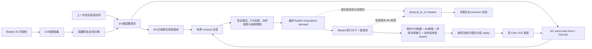

# WT15 15 MW 风机 state20 强化学习控制技术方案交付书

**文档版本：** 1.0  
**编写日期：** 2026-10-26  
**适用工程：** 当前工作区的 15 MW Bladed 风机工程  
**当前活动组件发行：** `WT15_STATE20_RL_20261023_R2`  
**文档性质：** 技术方案与现有实现说明；不构成策略验收、结构安全证明、生产投运许可或独立审计结论。

> 本文以当前 R2 配置、冻结工件和源码为准。R2 是离线开发候选：`release_ready=false`，Bladed 启动、策略验收、独立审计、soft/hard 控制与 RL 载荷裕量授权均为 false。历史实验和图表只作为有明确来源的开发证据，不能替代 R2 的新批次验收。[R2 发行清单](../RL/configs/WT15_STATE20_RL_20261023_R2/release_manifest.json) [R2 配置说明](../RL/configs/WT15_STATE20_RL_20261023_R2/README.md)

## 摘要

针对 15 MW 风机在多风况和额定功率跨区运行时的功率—叶根载荷协同控制问题，本文交付一套当前实现的分层数据驱动控制方案：采用因果 20 维状态观测识别运行区，以区域条件联合线性模型 B4 生成 torque/pitch 基线，再由行为克隆（BC）初始化的双延迟深度确定性策略梯度（TD3）Actor 输出有界残差；安全控制层对模式准入、异常/低转速保护、桨距保护、动作投影和速率限制负责。训练奖励以严格配对的同工况 PID 电量和三叶片叶根 My 峰值为基准，回放按风况与执行模式分层。另配置灰箱—因果 FIR 载荷预测器 `physical_fir_v2` 作为发送后只读影子，用于迁移诊断，不进入策略动作、reward 或 replay。

方案的主要特点是“基线先行、策略小幅残差、执行层确定性投影、预测旁路与控制链隔离”。技术边界同样明确：奖励和 dual multiplier 是优化信号，不是硬约束；物理影子的经验覆盖来自复用开发 validation，不是安全概率保证；离线 PID 标签和训练指标不能推导未执行候选动作的因果载荷响应。当前 BC 独立 holdout 已有 90,003 样本的 teacher-forced 误差结果；历史 4 风况训练和 D0-R 载荷模型也有开发结果，但均不能宣称 R2 已完成运行或验收。

**关键词：** 风力发电机组；状态识别；残差控制；行为克隆；TD3+BC；叶根弯矩；灰箱模型；因果 FIR；影子预测

## 1. 方案范围与总体结论

### 1.1 控制目标

控制器在每个仿真采样时刻根据当前机组状态，输出发电机 torque demand 与桨距 demand（当前控制接口为 `O_PitchPositionDemand1`）。策略训练目标是在维持或改善同工况 PID 能量基准的同时，降低三个叶片叶根 My 的全窗峰值，并抑制动作剧烈变化和持续功率亏损。

本方案按两层理解目标：

1. **学习目标：**最大化折扣累计 reward。相对 PID 功率、My 峰值、持续功率缺口和动作连续性在 reward 中按权重折算。
2. **验收目标：**在同一工况、同一有效仿真时间窗、同一时间对齐和严格 case identity 下，比较 RL/PID 的累计电量及三片叶根 My 峰值。验收公式与门槛见第 12 节。

这两个目标不等价：reward 是训练信号，官方验收是运行结果统计；任何 reward 项、动作包络或 shadow margin 均不能替代验收。

### 1.2 活动方案组件

当前活动主链为：

- state20：20 维因果控制观测；
- 状态/区域条件 B4 v3：每个控制区一个 torque/pitch 联合增量基线；
- state20 BC v3：冻结的 residual Actor 初始策略；
- TD3+BC：双 Critic 在线学习与行为约束；
- `SafeResidualController`：执行模式选择、保护、边界投影与速率限制；
- `physical_fir_v2`：独立 read-only shadow worker，预测已发送动作下的短窗 My，仅记日志。

完整控制链不应被概括成“神经网络直接输出最终物理动作”：Actor 输出的是归一化残差；B4 提供参考动作；安全层可能屏蔽残差、应用保护或改变最终动作。[架构与实现说明](RL模型架构与物理影子模型说明.md) [活动训练配置](../RL/configs/WT15_STATE20_RL_20261023_R2/state20_physical_23wind_round600_training.json)

虚线 shadow 支路没有连接回 B4、Actor、动作投影、reward 或 replay。该隔离是当前配置的设计边界，不是载荷安全认证。[物理 shadow bundle](../RL/configs/WT15_STATE20_RL_20261023_R2/physical_load_shadow_bundle.json) [shadow 实现](../RL/utils/physical_load_shadow.py)

## 2. 问题定义与符号

设仿真时间为 $t_n=n\Delta t$，活动配置中 $\Delta t=0.02\ \mathrm{s}$。第 $n$ 步状态、控制、功率和叶根弯矩分别记为：

$$
\mathbf{x}_n=[\psi_n,\omega_n,\gamma_n,T_{e,n},\omega_{g,n},P_{r,n},\beta_n,a_{FA,n},a_{SS,n},V_n]^{\mathsf T},\qquad
\mathbf{u}_n=[T^{cmd}_n,\beta^{cmd}_n]^{\mathsf T},\qquad
\mathbf{m}_n=[My_{1,n},My_{2,n},My_{3,n}]^{\mathsf T}.
$$

其中，$\psi$ 为转子方位角，$\omega$ 为转子转速，$\gamma$ 为偏航误差，$T_e$ 为电磁转矩反馈，$\omega_g$ 为发电机转速，$P_r$ 为实功率状态，$\beta$ 为实测桨距，$a_{FA}$ 与 $a_{SS}$ 为机舱前后/侧向加速度，$V$ 为平均风速；$T^{cmd}$ 单位 Nm，$\beta^{cmd}$ 单位 rad；$My_j$ 是第 $j$ 片叶片的叶根弯矩，单位 Nm。

策略输出是对 B4 基线的有界修正，不是绝对动作。令 $\mathbf{b}_n$ 表示 B4 基线物理动作，$\mathbf{r}_n$ 表示 Actor residual，$\mathbf{L}(q_n,V_n)$ 表示由运行状态 $q_n$ 和滤波风速决定的 residual envelope，则保护前的策略请求为

$$
\mathbf{u}^{req}_n=\mathbf{b}_n+\mathbf{r}_n\odot\mathbf{L}(q_n,V_n).
$$

最终发送动作 $\mathbf{u}^{sent}_n$ 还要通过控制器的执行模式、PID 包络保护、绝对边界和动作速率变换。以下章节分别说明各环节；所有边界都只约束控制器请求/发送值域，不是未来结构载荷界。

## 3. 数据合同、PID 配对与身份管理

### 3.1 输入字段和训练数据

Bladed 数据合同 `bladed_udp_19_si_my_v1` 包含 19 个字段：时间、9 个状态变量、平均风速、两项 torque/pitch demand、两个辅助桨距量、Electrical power、Real power 以及三片 blade-root My。**Actor 输入并非 19 维**：它使用 9 个状态量和风速形成 10 个基础变量，再追加上一步动作及 8 个状态/区域类别量，总计 20 维。两个辅助桨距量和 My 不直接作为 Actor 特征；My 用于 reward 与载荷评价。[变量定义](../RL/utils/constants.py) [state20 合同](../RL/data/resolved_control_contract_state20_600s_v3.json)

当前 BC residual 数据集合同记录：

- `bladed-data-new/raw`：风况 3–25，共 23 个文件；每文件 30,001 行、0–600 s、20 ms 采样，总计 690,023 行。
- `bladed-data-new/raw_infer`：独立 holdout 文件；BC validation 90,003 行，对应 3 个 holdout case。
- BC manifest 标记 `train_source_role=raw_pid_calibration`、`validation_source_role=raw_infer_holdout`，并绑定 B4、state/action envelope 和来源文件 SHA-256。

因此，BC holdout 是与训练 CSV 分离的轨迹级 holdout，不是全新风种子总体的统计置信保证，也不是闭环 Bladed 验收。[BC residual 数据 manifest](../RL/data/b4_centered_residual_bc_state20_v2/manifest.json) [BC holdout 报告](../RL/data/b4_centered_residual_bc_state20_v2/val_bc_evaluation.json)

### 3.2 PID reference 与动作来源边界

paired PID reference 对每个 condition 同时记录功率、三片 My、准确仿真时间戳及风迹线身份；配对要求同 case、同 seed、同时间窗，逐时间戳精确对齐，不插值。600 s 和 180 s reference 是不同工件，不得混用。[600 s paired PID reference](../RL/data/paired_pid_power_load_reference_3_to_25_600s_v2.json) [180 s paired PID reference](../RL/data/paired_pid_power_load_reference_3_to_25_180s_v2.json)

历史 PID CSV 的 `O_PcsTorqueDemand` / `O_PitchPositionDemand1` 按当前训练合同作为 recorded PID demand 标签。来源审计结论是 `recorded_pid_demand` 可用于离线 teacher/baseline 构造，但 `native_pid_demand_available=false`；这不意味着当前 DLL 的同名 O 字段是 setter readback。审计同时记录当前 DLL 的 O 字段上报来源是 `I_ElectricalTorque`、`I_PitchPosition1` measurement alias，demanded getter 未作为 UDP 上行源。因此，不能将历史 `O_*`、当前已发送 demand 和实际反馈量 `I_*` 混为同一信号，也不能把 BC/B4 holdout 解释为未执行替代动作的因果效应。[PID 来源审计工件](../RL/data/pid_reference_provenance_3_to_25.json) [动作合同](../RL/data/resolved_control_contract_state20_600s_v3.json)

项目中 request torque high 为 $21{,}586{,}451.33303\ \mathrm{Nm}$，pitch 范围 $[0,0.43]\ \mathrm{rad}$；这与 `I_ElectricalTorque` 约 21 MNm 的物理反馈上限是不同量。B4/BC/RL 的工件 hash 和控制指纹用于防止配置不一致，不会自动证明历史风种子、工程文件或每个运行 trace 的严格身份。

## 4. 因果运行状态估计与 state20 观测

### 4.1 风速滤波和状态/区域分类

分类器对原始风速做因果指数滤波：

$$
\bar V_n=\bar V_{n-1}+\alpha_n(V_n-\bar V_{n-1}),\qquad
\alpha_n=1-\exp\left(-\frac{\Delta t_n}{\tau_V}\right),\qquad \tau_V=2.0\ \mathrm{s}.
$$

控制区 $r_n\in\{\mathrm{below},\mathrm{transition},\mathrm{above}\}$ 使用滞回和持续确认：进入过渡区阈值 11.8 m/s、退出阈值 11.2 m/s；进入额定以上阈值 13.8 m/s、退出阈值 13.2 m/s；切换候选需持续 1.0 s。启停分类另外使用运行转速 $0.5\ \mathrm{rad/s}$、停机转速 $0.4\ \mathrm{rad/s}$、发电功率 100 kW、负功率异常阈值 −1 kW，并有 1 s 确认。分类器是有状态的因果规则，不是根据未来风速标签直接分区。[运行状态分类器](../RL/utils/operating_state.py) [状态/动作工件](../RL/data/state_action_envelope_3_to_25_v1.json)

运行状态映射到 5 个优化类别：startup/stopped、below-rated、transition、above-rated、negative-power abnormal；同时保留 3 个控制区类别。两组 one-hot 表示不同概念：前者控制优化与保护语义，后者选择 B4 区域模型。

### 4.2 20 维观测构造

定义 10 维基础观测

$$
\mathbf{x}^{10}_n=[\psi_n,\omega_n,\gamma_n,T_{e,n},\omega_{g,n},P_{r,n},\beta_n,a_{FA,n},a_{SS,n},V_n]^{\mathsf T}.
$$

叶片方位角折返到 $[0,2\pi)$。上一步实际发送动作使用工程上下界映射到 $[-1,1]$：

$$
\tilde u_{n-1,d}=\operatorname{clip}\left(2\frac{u_{n-1,d}-u_{d,low}}{u_{d,high}-u_{d,low}}-1,-1,1\right),\qquad d\in\{T,\beta\}.
$$

完整 Actor observation 为

$$
\mathbf{o}_n=\left[\mathbf{x}^{10}_n,\tilde{\mathbf{u}}_{n-1},\operatorname{onehot}(q_n)\in\{0,1\}^5,\operatorname{onehot}(r_n)\in\{0,1\}^3\right]\in\mathbb{R}^{20}.
$$

特征次序与定义见 [BC manifest 的 observation schema](../RL/data/b4_centered_residual_bc_state20_v2/manifest.json)。Actor 不是 RNN，不直接输入 My 历史、PID 峰值或 shadow 输出；其历史信息通过上一动作、因果风速滤波、分类器滞回及控制器保存的保护状态体现。

网络输入按训练样本 median/IQR 归一化并截断：

$$
\hat o_{n,i}=\operatorname{clip}\left(\frac{o_{n,i}-m_i}{s_i+\epsilon},-10,10\right),\qquad s_i=\mathrm{IQR}_i.
$$

当前实现通过冻结的 observation normalizer buffer 共享同一归一化参数给 Actor、target Actor、执行 Actor 和两个 Critic。[Actor MLP](../RL/models/actor_mlp.py) [Critic MLP](../RL/models/critic_mlp.py)

## 5. B4：状态分区的 torque/pitch 联合基线

### 5.1 特征与回归

每个控制区独立拟合一个 6 输入、2 输出的线性增量模型。令

$$
\mathbf{z}_n=[\bar V_n,\omega_n,\omega_{g,n},P_{r,n},T^{sent}_{n-1},\beta^{sent}_{n-1}]^{\mathsf T},\qquad
\tilde{\mathbf z}_{n,r}=(\mathbf z_n-\boldsymbol\mu_r)\oslash\mathbf{s}_r.
$$

区域 $r$ 的联合输出为

$$
\widehat{\Delta\mathbf u}_{n,r}=\mathbf c_r+\tilde{\mathbf z}_{n,r}^{\mathsf T}\mathbf W_r,
\qquad
\mathbf W_r\in\mathbb{R}^{6\times2}.
$$

$\mathbf c_r$ 为截距，$\mathbf W_r$ 同时预测 torque 和 pitch 增量；B4 artifact 采用 multi-output ridge 回归，$\alpha=1.0$。训练样本来自 raw 中所有有效因果相邻转移：below-rated 265,791、transition 66,609、above-rated 357,600。三个模型都声明 `next_realized_action_delta`，不是读取未来特征的预测器。[B4 baseline 工件](../RL/data/region_aware_joint_baseline_state20_3_to_25_v3.json) [B4 实现](../RL/utils/region_aware_baseline.py)

### 5.2 区域混合与基线动作

区域交界处通过 hysteresis 分类加 smoothstep 混合，$h(\xi)=3\xi^2-2\xi^3$。根据当前区域得到权重 $w_r(\bar V_n)$，满足 $w_r\geq0$ 且 $\sum_r w_r=1$。B4 动作为

$$
\mathbf b_n=\Pi_{\mathcal U}\left[\mathbf u^{sent}_{n-1}+\Pi_{\Delta\mathcal U_{B4}}\left(\sum_r w_r(\bar V_n)\widehat{\Delta\mathbf u}_{n,r}\right)\right],
$$

其中 $\mathcal U=[0,21.58645133303\ \mathrm{MN m}]\times[0,0.43\ \mathrm{rad}]$，B4 delta 限制为 torque $\pm15\ \mathrm{kN m}$、pitch $\pm0.0003\ \mathrm{rad}$。该 B4 是统计学 control baseline，不是固定 PID 表、气动载荷模型或安全边界。

## 6. BC v3 与有界 residual Actor

### 6.1 BC target

对历史记录 PID 动作先施加工程边界，得到有效标签 $\mathbf u^{PID,eff}_n$。定义状态相关 envelope $\mathbf L_n=\mathbf L(q_n,\bar V_n)$，BC 标签为

$$
\mathbf y^{BC}_n=0.25\cdot\operatorname{clip}\left(\frac{\mathbf u^{PID,eff}_n-\mathbf b_n}{\mathbf L_n},-1,1\right),
$$

逐动作维计算；若某状态下对应 envelope 为 0，则该维目标 residual 定义为 0。BC 预训练使用 SmoothL1、batch 256、5,000 次更新，冻结 Critic；当前在线 R2 配置 `bc.steps=0`，从已冻结 BC v3 checkpoint warm-start，不在每次在线训练时重做 BC。[BC v3 预训练配置](../RL/configs/b4_residual_smoke/bc_pretrain_b4_state20_residual_600s_v3.json) [BC checkpoint](../RL/BC_checkpoint/bladed_pid_b4_state20_residual_v3.pt)

### 6.2 Actor 网络与 residual envelope

Actor 为 $20\rightarrow256\rightarrow256\rightarrow128\rightarrow2$ 的 SiLU MLP，输出

$$
\mathbf r_n=0.25\tanh(f_\theta(\hat{\mathbf o}_n))\in[-0.25,0.25]^2.
$$

BC 目标和 TD3 Actor 均使用此 residual target scale。策略执行前的物理动作是

$$
\mathbf u^{policy}_n=\mathbf b_n+\mathbf r_n\odot\mathbf L_n.
$$

状态 envelope 单位为 Nm/rad：startup/stopped 与 negative-power abnormal 为 $(0,0)$；below-rated 为 $(15{,}000,0.00030)$；transition 为 $(15{,}000,0.00035)$；above-rated 为 $(20{,}000,0.00035)$。在风速滞回带中按 smoothstep 连续插值。由于 Actor 的 $0.25$ scale，残差策略对 B4 的单步修正幅度通常不超过 envelope 的四分之一，例如 below-rated torque 为 $\pm3.75$ kNm。该值只描述策略局部修正能力；B4 基线自身的动作变化、安全保护和最终投影仍是独立环节。[state/action envelope 构造器](../RL/utils/state_action_artifact.py) [安全 residual 控制器](../RL/utils/safe_residual_control.py)

### 6.3 BC 误差

当前 holdout 报告使用 90,003 个 raw_infer 样本，归一化 residual MAE 为 torque 0.05568、pitch 0.03585，RMSE 为 0.07128、0.05395。它是 teacher-forced 的离线动作拟合误差，单位是 normalized residual，不是 Nm/rad，也不等价于闭环功率或载荷收益。[BC holdout 结果](../RL/data/b4_centered_residual_bc_state20_v2/val_bc_evaluation.json)

## 7. 安全执行层与最终发送动作

### 7.1 执行模式与准入

`SafeResidualController` 在动作投影之前，根据状态/执行健康决定 residual 是否准入。当前实现至少区分 actor、显式 baseline、actor execution rollback、OOD baseline、startup/stopped baseline、negative-power baseline、低速 warning/protection/emergency/recovery 等执行模式。对于 startup/stopped、负功率异常、低转速保护、OOD 超限或执行 Actor 非有限等情况，Actor residual 可被置零，选择 B4/baseline/保护动作。[执行模式合同](../RL/utils/control_execution.py)

OOD 分数基于训练集 median/IQR，对连续特征取最大标准化偏差；state/region one-hot 按类别有效性校验，不当作连续距离。阈值 6.0 是本合同的门控值，不是“6 个标准差”的概率保证。

### 7.2 桨距/低速保护和物理投影

额定附近的动态 PID envelope 在满足风速与转速/功率/加速度进入条件时锁存当前 pitch floor；全部 release 条件回到滞回退出侧时释放。低速 `pid_envelope_staged` 根据转速、转速变化率和发电状态切换 warning/protection/recovery/emergency stage，对 torque 执行缩放或卸载。R2 配置的 warning/protection torque scale 分别为 0.9/0.7；应急 stage 的 torque 可卸载至配置下限。该逻辑来自 S2/U1 PID envelope，不是 Ct 调度，也不是 My 物理上界。[S2/U1 保护配置](../RL/data/s2_u1_pid_envelope_3_to_25.json) [保护逻辑实现](../RL/utils/safe_residual_control.py)

设保护后请求为 $\mathbf u^{post}_n$、上一时刻实际发送动作为 $\mathbf u^{sent}_{n-1}$。执行变换可写为

$$
\mathbf u^{sent}_n=
\Pi_{\mathcal U}\left[
\mathbf u^{sent}_{n-1}+
\Pi_{[\Delta\mathbf u_{low},\Delta\mathbf u_{high}]}
\left(\Pi_{\mathcal U}(\mathbf u^{post}_n)-\mathbf u^{sent}_{n-1}\right)
\right].
$$

R2 engineering bounds 为 torque $[0,21{,}586{,}451.33303]\ \mathrm{Nm}$、pitch $[0,0.43]\ \mathrm{rad}$；每个 20 ms 步动作增量界为 torque $\pm90{,}000\ \mathrm{Nm}$、pitch $\pm0.000698\ \mathrm{rad}$。最终 command 以 float64 合同序列化。低速应急卸载可以 bypass torque decrease rate limit，但仍受最终物理 command bounds 限制。[物理动作合同及投影](../RL/utils/control_contract.py) [R2 resolved contract](../RL/data/resolved_control_contract_state20_600s_v3.json)

上述投影只约束给 Bladed 的命令范围和变化率，不代表 $My$ 不超 PID 峰值，不覆盖 DLL 的 command/readback 误差、执行器滞后、风况迁移或未知物理响应。

## 8. Reward 与 dual constraint

### 8.1 主功率项：相对 PID 的单步能量增量

paired reference 按同 condition、同仿真时间戳精确查找。令 $P_{n+1}$ 为 transition 末端实测 Electrical power，$P^{PID}_{n+1}$ 为配对 PID 功率，则

$$
C_{P,n}=\operatorname{clip}\left(\frac{(P_{n+1}-P^{PID}_{n+1})\Delta t}{300{,}000\ \mathrm{J}},-2,2\right).
$$

$C_P>0$ 表示该步 RL 电功率高于 PID；15 MW 是额定功率参考，300 kJ 是每个 20 ms transition 的相对能量归一化尺度。该训练 reward 与最终验收所用的全轨迹梯形积分不同。

### 8.2 三叶片峰值超额

每个 condition 内按叶片维护累计绝对峰值：

$$
M_{j,n}=\max_{k\leq n}|My_{j,k}|,\qquad
 e_{j,n}=\max\left(\frac{M_{j,n}}{M^{PID}_j}-1,0\right),
$$

其中 $M^{PID}_j$ 是 paired PID 同 condition、同 reference window 的第 $j$ 片全窗峰值。活动配置的 peak aggregation 为 `max`：

$$
C_{My,n}=\max_j\max(e_{j,n}-e_{j,n-1},0).
$$

该项只惩罚本步新增加的 PID 峰值超额；若累计峰值没有进一步增大，本步增量即为零。与它不同的持续超额项 $C_{My,cont,n}$ 单列于下一节。两者都基于已观测 My，不是未来峰值预测硬门。[reward 实现](../RL/utils/reward.py)

### 8.3 持续/累积叶根峰值超额

沿用第 8.2 节的逐叶片累计峰值 $M_{j,n}$ 和超额比例 $e_{j,n}$，持续载荷超额项定义为

$$
C_{My,cont,n}=\max_j e_{j,n}
=\max_j\max\left(\frac{M_{j,n}}{M^{PID}_j}-1,0\right),\qquad
M_{j,n}=\max_{k\leq n}|My_{j,k}|.
$$

它与 $C_{My,n}$ 的区别是：$C_{My,n}$ 表示超额的**本步新增量**，只有累计峰值进一步抬高时才为正；$C_{My,cont,n}$ 表示截至当前步的**累计超额水平**。例如某叶片的 PID 峰值为 $100\ \mathrm{MNm}$，RL 累计峰值从 $99$ 升到 $102\ \mathrm{MNm}$ 时，$C_{My,n}=0.02$、$C_{My,cont,n}=0.02$；下一步若峰值仍为 $102\ \mathrm{MNm}$，则 $C_{My,n}=0$，但 $C_{My,cont,n}$ 仍为 $0.02$。若累计峰值再升至 $103\ \mathrm{MNm}$，二者分别为 $0.01$ 和 $0.03$。因此 $C_{My,cont,n}$ 不是瞬时 My，也不是 My 时间波动的连续性指标；超过 PID 参考后会保持为正，直至 condition 重置。

R2 中该项的基础权重为 $0.05$，以 $-0.05\,m_{cont}(q_n)C_{My,cont,n}$ 进入 reward。状态倍率 $m_{cont}$ 在 below-rated/transition 为 $0.05$、above-rated 为 $0.1$，对应总系数分别为 $0.0025$ 和 $0.005$；完整状态权重表见第 8.4 节。

### 8.4 其他活动项与状态权重

本节给出当前仍参与基础 reward 的持续功率缺口与动作连续性代价。令 $n$ 表示当前控制步，$n+1$ 表示动作执行后获得的测量帧，$\Delta t_n=t_{n+1}-t_n$（名义值 $0.02\ \mathrm{s}$）。$P_{n+1}$ 与 $P^{PID}_{n+1}$ 分别表示同一 condition、同一仿真时刻下 RL 与配对 PID 的电功率，单位 W；当前 $P_{ref}=P_{rated}=15\ \mathrm{MW}$。$T^{sent}_n$、$\beta^{sent}_n$ 表示安全执行层最终发送的扭矩和桨距命令，单位分别为 Nm 与 rad。$x_+=\max(x,0)$ 表示正部，$\operatorname{clip}(x,a,b)$ 表示将 $x$ 限制在 $[a,b]$。

**动作连续性代价。**相邻两步最终发送命令的变化量定义为

$$
C_{T,n}=\frac{|T^{sent}_n-T^{sent}_{n-1}|}{15{,}000\ \mathrm{Nm}},\qquad
C_{\beta,n}=\frac{|\beta^{sent}_n-\beta^{sent}_{n-1}|}{0.0003\ \mathrm{rad}}.
$$

分母是代价的归一化参考尺度而非死区或动作限幅；因此只要相邻发送命令发生变化，该代价即可为正。$C_{T,n}$ 与 $C_{\beta,n}$ 均无量纲，分别由状态权重 $m_{act}(q_n)$ 加权后进入基础 reward。

**持续功率缺口代价及其容差。**令 $\delta_P$ 表示功率缺口容差，$d_n$ 表示扣除容差后的瞬时缺口，$\bar d_n$ 表示其指数加权移动平均（EWMA），则

$$
\begin{aligned}
\delta_P&=0.01P_{ref}=150\ \mathrm{kW},\\
d_n&=(P^{PID}_{n+1}-P_{n+1}-\delta_P)_+,\\
\alpha_{d,n}&=1-\exp(-\Delta t_n/\tau_d),\qquad \tau_d=2\ \mathrm{s},\\
\bar d_n&=\bar d_{n-1}+\alpha_{d,n}(d_n-\bar d_{n-1}),\\
C_{def,n}&=\operatorname{clip}(\bar d_n/P_{ref},0,1).
\end{aligned}
$$

其中 $d_n$、$\bar d_n$ 的单位为 W，$\alpha_{d,n}$ 与 $C_{def,n}$ 无量纲；每个 condition 开始时 EWMA 状态清零。该功率死区是**单侧容差**：仅当 $P^{PID}_{n+1}-P_{n+1}>150\ \mathrm{kW}$ 时触发，进入 EWMA 的是超出 150 kW 的部分；缺口不超过 150 kW 时 $d_n=0$。例如 PID 功率比 RL 高 200 kW 时，EWMA 的瞬时输入为 50 kW。

该容差只作用于持续缺口项 $C_{def,n}$，不作用于第 8.1 节的主相对能量项 $C_{P,n}$；后者按实际 $P_{n+1}-P^{PID}_{n+1}$ 计算。因此 150 kW 以内的功率亏损仍会影响主功率 reward。缺口回到容差范围后，瞬时输入 $d_n$ 归零，但已有 EWMA 按 $\tau_d=2\ \mathrm{s}$ 衰减，并非立即清零。

转速及电功率测量仍用于 state20、运行状态分类和控制安全逻辑，但当前 reward 不再加入转速偏差、转速变化、持续低速或独立负功率扣分。低速保护、负功率异常分类及相应动作回退/停止由独立控制层负责，未随奖励项删除。[运行状态分类](../RL/utils/operating_state.py) [安全控制器](../RL/utils/safe_residual_control.py)

状态权重表仅包含当前仍参与 reward 的类别倍率；分类器在风速滞回过渡区对相邻类别采用 smoothstep 连续插值：

| 优化状态 | $m_P$ | $m_{My}$ | $m_{cont}$ | $m_{def}$ | $m_{act}$ |
|---|---:|---:|---:|---:|---:|
| startup/stopped | 0 | 0 | 0 | 0 | 0 |
| below-rated | 1 | 0.5 | 0.05 | 0.1 | 0.1 |
| transition | 0.75 | 0.75 | 0.05 | 0.1 | 0.15 |
| above-rated | 0.5 | 1 | 0.1 | 0.25 | 0.15 |
| negative-power abnormal | 0 | 0 | 0 | 0 | 0 |

表中 $m_i(q_n)$ 是按当前优化状态 $q_n$ 选取的无量纲状态倍率，不是独立的 reward 项；它们与基础 reward 方程中的固定系数相乘。各倍率的含义如下：$m_P$ 调节相对 PID 单步能量项 $C_{P,n}$；$m_{My}$ 调节第 8.2 节定义的本步峰值超额增量 $C_{My,n}$；$m_{cont}$ 调节第 8.3 节定义的累计峰值超额 $C_{My,cont,n}$；$m_{def}$ 调节 EWMA 平滑后的持续功率缺口 $C_{def,n}$；$m_{act}$ 调节最终发送扭矩和桨距的变化代价 $C_{T,n}+C_{\beta,n}$。该列表不含已从 reward 移除的转速或独立负功率项。

### 8.5 当前基础 reward 方程

不含 dual penalty 的基础 reward 按实现可整理为

$$
\begin{aligned}
r^{base}_n={}&1.0\,m_P(q_n)C_{P,n}
-1.0\,m_{My}(q_n)C_{My,n}
-0.05\,m_{cont}(q_n)C_{My,cont,n}\\
&-0.0005\,m_{act}(q_n)(C_{T,n}+C_{\beta,n})
-0.1\,m_{def}(q_n)C_{def,n}.
\end{aligned}
$$

配置虽保留 acceleration、shaft、command-excess、power-tracking、power-floor 项，但对应基础权重均为 0，不影响当前 reward。当前训练 reward 不含转速惩罚或独立负功率扣分；负功率仍可通过主相对 PID 功率项和持续功率缺口项影响 reward。控制器仍保留负功率异常识别/回退和独立低速保护；本次只移除专门 reward 项，不修改状态分类、残差准入或安全处置。该 reward 变更尚无新的 R2 闭环性能验证。

### 8.6 自适应 dual penalty

condition 结束时计算三片峰值超额 $g_{L_j}$ 和总能量亏损百分比 $g_E$。按完整 condition/round 更新

$$
\lambda^{k+1}_i=\operatorname{clip}\left(\lambda^k_i+\eta_i\,\overline{g_i}^{\,round},0,\lambda_{max,i}\right).
$$

当前 $\epsilon_{L_j}=0$、$\epsilon_E=0\%$；$\eta_{L_j}=2.0$、$\eta_E=0.5$；所有 multiplier 上限为 10、初值为 0。每个 transition 追加的 reward penalty 为

$$
\Pi^{dual}_n=\left(\sum_{j=1}^{3}\lambda_{L_j}\right)\max_j\Delta e_{j,n}
+\lambda_E\max\left(\frac{P^{PID}_{n+1}-P_{n+1}}{P^{PID}_{n+1}},0\right),
\qquad
r_n=r^{base}_n-\Pi^{dual}_n.
$$

能量 condition violation 使用整窗累计能量计算；step penalty 使用单步相对功率亏损分数，二者口径不同。由于初始 $\lambda=0$ 且只在完整 condition/round 更新，dual 项是延迟、自适应的软惩罚，不是每步硬屏蔽，更不是 CMDP 可行性证明。[dual 约束实现](../RL/utils/dual_constraint.py) [训练接线](../RL/train_rl.py)

## 9. TD3+BC 学习器

### 9.1 网络结构

Actor 输入为 $20$ 维 observation，隐藏宽度 $[256,256,128]$，SiLU 激活，输出 2 维有界 residual。单个 Actor 参数量 104,322。两个 Critic 输入为 $20$ 维 state 与 2 维 normalized action 拼接，结构 $22\rightarrow256\rightarrow256\rightarrow128\rightarrow1$，每个 104,705 个参数。含在线/target/execution 副本，一个 TD3 agent 的网络参数合计约 731,786；优化器直接更新在线 Actor 和两个在线 Critic。[TD3 实现](../RL/agents/td3.py)

### 9.2 Critic target 与损失

TD3 target-policy smoothing 使用

$$
\epsilon\sim\operatorname{clip}(\mathcal{N}(0,0.005^2),-0.01,0.01),\qquad
\mathbf a'=\operatorname{clip}(\pi_{\theta^-}(\mathbf o')+\epsilon,-0.25,0.25).
$$

双 target Critic 取较小值：

$$
y_n=r_n+\gamma(1-d_n)\min_{i\in\{1,2\}}Q_{i,\phi_i^-}(\mathbf o_{n+1},\mathbf a'),\qquad \gamma=0.999.
$$

每个 Critic 使用 Huber/SmoothL1 delta $1.0$：

$$
L_{Q_i}=\mathbb E\left[\operatorname{SmoothL1}(Q_{i,\phi_i}(\mathbf o_n,\mathbf a_n)-y_n)\right],\quad i=1,2.
$$

Critic 学习率 $5\times10^{-5}$、Actor 学习率 $3\times10^{-5}$、Polyak target 比例 $\tau=0.005$、Actor 延迟系数 `policy_delay=4`。训练配置还启用 $|Q'|$ 与 Actor-Q 数值 guard，超过阈值会跳过相应更新；这些是数值健康门，不是物理安全阈值。

### 9.3 Actor 的 TD3+BC 目标

Actor 的强化学习项和 BC 项为

$$
L_{RL}=-\lambda_Q\,\mathbb E[Q_1(\mathbf o,\pi_\theta(\mathbf o))],\qquad
\lambda_Q=\frac{\alpha}{\max\left(\mathbb E|Q_1(\mathbf o,\pi_\theta(\mathbf o))|,10^{-6}\right)},\qquad \alpha=1,
$$

$$
L_{BC}=\mathbb E_{(\mathbf o,y)\sim D_{BC}}\left[\operatorname{SmoothL1}(\pi_\theta(\mathbf o)-y)\right],\qquad
L_{actor}=L_{RL}+w_{BC}L_{BC}.
$$

$w_{BC}$ 以基础权重 1.0 起步；`td3_bc_target_ratio=0.5` 时，在未触及 $10^5$ 权重上限的情况下，动态提高 BC 项，使其相对于 RL 项达到预设比例下限。该比例控制的是 loss 的相对尺度，不表示“动作有 50% 来自 PID”。`policy_noise` 只用于 target action 平滑；R2 现场采集、Critic、Actor 探索噪声均设为 0。[TD3+BC 实现](../RL/agents/td3.py) [模型结构说明](RL模型架构与物理影子模型说明.md)

### 9.4 Replay 与健康门

R2 默认训练采用 condition-stratified replay：每个 condition 容量 40,000 条，达到 5,000 条有效转移后满足最低覆盖条件；batch size 128，每个有样本的 condition 至少采 5 条，再分配剩余名额。执行模式 replay 合同允许 actor、显式 baseline stage、actor execution rollback baseline、low-speed recovery hold 等明确列举的模式，并拒绝 timeout、invalid、unsafe-stop 和 condition-boundary 等 post-step outcome。模式来源保存在 replay，便于分组审计。存入 critic replay 的动作是安全执行后相对 B4 的已执行 residual：

$$
\mathbf a^{replay}_n=\begin{cases}
\operatorname{clip}\left((\mathbf u^{sent}_n-\mathbf b_n)\oslash\mathbf L_n,-1,1\right),&\mathbf L_n>0,\\
\mathbf 0,&\mathbf L_n=0.
\end{cases}
$$

该回放动作的范围通常为 $[-1,1]$；Actor/target Actor 输出仍被限制在 $[-0.25,0.25]$。因此，策略 raw residual、保护后执行 residual 和物理发送动作是不同量。[分层回放实现](../RL/replay/replay_buffer.py) [执行模式合同](../RL/utils/control_execution.py) [训练回放筛选逻辑](../RL/train_rl.py)

Critic Q-health 每 200 次更新检查窗口，允许 guard rate 不高于 5%、成功率不低于 90%，连续 3 个失败窗口中止。Actor optimizer health gate 要求固定 256 样本的离线 health batch 有效，并要求连续 200 次健康 Critic update 后才允许恢复 Actor update。配置保留的 `actor_q_health_gate` 字段不等于同时运行第二个 actor-Q gate；当前训练入口优先使用 optimizer health gate。[R2 训练健康门配置](../RL/configs/WT15_STATE20_RL_20261023_R2/state20_physical_23wind_round600_training.json) [训练操作笔记](训练操作笔记.md)

## 10. 载荷预测器：灰箱 + 因果 FIR 只读影子

### 10.1 功能边界

`physical_fir_v2` 使用与冻结 D0-R 相同的物理/动态工件，对**已成功发送**的 RL demand ZOH 轨迹做分布迁移诊断。运行时每 5 帧抽一个 origin（约 10 Hz），主要预测 0.10 s 和 0.20 s；预测提交在动作发送后，不改变当前动作、reward、replay 或策略输入。域外、历史不足、身份/数据不完整时必须返回 unknown，而不是把未知当安全。bundle 明确 `nn_active=false`、`legacy_action_provenance_verified=false`、`rl_action_response_validated=false`，`soft_authorized=false`、`hard_authorized=false`。[physical shadow bundle](../RL/configs/WT15_STATE20_RL_20261023_R2/physical_load_shadow_bundle.json) [runtime worker](../RL/utils/physical_load_shadow.py)

### 10.2 物理启发的静态弯矩表面

对每片叶片 $j$ 定义轴向来流、切向速度、简化入流角和桨距归一量：

$$
V_x=V\cos\gamma,\qquad V_\theta=\omega R_{eff},\qquad
\phi=\frac{\operatorname{atan2}(V_x,V_\theta)}{0.25},\qquad
\beta^*=\frac{\beta}{0.2},\qquad \psi_j=\psi+\frac{2\pi(j-1)}{3},\quad j\in\{1,2,3\}.
$$

其中 $R_{eff}=0.67R$ 是显式集总近似，$R$ 为转子半径。模型使用按 moment scale $M_0=10^7\ \mathrm{Nm}$ 归一化的动压型量

$$
Q_{rel}=\frac{0.5\rho\pi R^2R_{eff}}{3M_0}(V_x^2+V_\theta^2),\qquad
Q_{ax}=\frac{0.5\rho\pi R^2R_{eff}}{3M_0}V_x^2.
$$

18 维特征 $\boldsymbol\varphi_j$ 由 $Q_{rel}$ 乘以 $\phi,\beta^*$ 的三阶多项式 10 项、$Q_{ax}$ 乘以 1P/2P 方位谐波 4 项、前后/侧向加速度及其方位调制 4 项组成。每个控制区、每片叶片拟合独立 ridge 系数 $\boldsymbol\theta_{r,j}$：

$$
\hat S_{r,j}(\mathbf z)=\boldsymbol\varphi_j(\mathbf z)^{\mathsf T}\boldsymbol\theta_{r,j}.
$$

这是一种经 PID 数据拟合的准稳态灰箱表面，不是 BEM、全气弹性求解器、实测模态模型，也不含完整 $C_p/C_t$ 气动曲线。有效半径比例等是明示近似参数。[物理模型协议](../RL/diagnostics/physical_load_margin_dynamic_v2/frozen_base_protocol.json) [灰箱特征与实现](../RL/utils/physical_load_margin.py)

### 10.3 执行器闭式响应与 My 锚定

物理 rollout 从 origin 实测 My 锚定，只外推未来控制影响，不以未来测量作为输入。发电机 torque 一阶响应时间常数为 $\tau_g=0.1\ \mathrm{s}$，转子惯量 $J=318{,}628{,}138\ \mathrm{kg\,m^2}$，实际 torque 模型受 $21\ \mathrm{MN\,m}$ cap 限制。令 $\Delta T=T^*-T_g(t)$，则未来时间 $h$ 的简化转速响应包含项

$$
\omega(t+h)=\omega_t+\dot\omega_t h-
\frac{\Delta T}{J}\left[h-\tau_g\left(1-e^{-h/\tau_g}\right)\right].
$$

pitch 执行器按 PositionResponse 二阶模型近似，$\omega_n=6.2831853\ \mathrm{rad/s}$、阻尼比 $\zeta=0.8$、$\omega_d=\omega_n\sqrt{1-\zeta^2}$：

$$
\beta(t+h)=\beta^*+e^{-\zeta\omega_n h}\left[
(\beta_t-\beta^*)\cos(\omega_dh)+
\frac{\dot\beta_t+\zeta\omega_n(\beta_t-\beta^*)}{\omega_d}\sin(\omega_dh)
\right].
$$

准稳态物理表面给出的 My 轨迹为

$$
\hat M^{phys}_{j,t+k}=My_{j,t}+\hat S_{r,j}(\hat{\mathbf z}_{t+k})-\hat S_{r,j}(\mathbf z_t).
$$

再用直接多步 FIR 对有符号未来 My 增量残差做修正：

$$
\hat M^{D0-R}_{j,t+k}=\hat M^{phys}_{j,t+k}+M_0\,\left(\boldsymbol\phi^{FIR}_{j,t}\right)^{\mathsf T}\mathbf B_{r,j,:,k},
\qquad k=1,\ldots,25,
$$

采样步长 20 ms，$\boldsymbol\phi^{FIR}_{j,t}\in\mathbb R^{52}$ 包含 16 个 origin 特征及 lag $[1,2,5,10,20,40]$ 帧上的 6 组历史特征（own/common surface residual 差、My 差、风速差和两向机舱加速度）；每个未来帧 $k$ 对应系数向量 $\mathbf B_{r,j,:,k}\in\mathbb R^{52}$。最长历史 lag 为 40 帧（0.80 s），ridge fraction $10^{-4}$；每个叶片/区域拟合有限窗直接线性系数，不递归把前一帧预测喂回下一帧。未来 My 只作为 train 标签，不进入 origin 特征。窗口预测值为

$$
\hat P_{j,t,H}=\max_{1\leq k\leq H/\Delta t}|\hat M_{j,t+k}|,
\qquad H\in\{0.10,0.20,0.50\}\ \mathrm{s}.
$$

D0-R v2 没有替代动作候选预测 API；离线拟合与选择依赖记录 PID demand 的近似 ZOH 支持域，不能据此宣称不同 RL 候选动作会有同样真实 My 响应。[冻结动态 FIR 模型](../RL/diagnostics/physical_load_margin_dynamic_v2/frozen_dynamic_model.json) [动态模型实现](../RL/utils/physical_load_margin_dynamic.py)

### 10.4 条件误差尺度与联合经验余量

独立误差尺度模型预测 $s_{j,H}(\mathbf x_t)$，训练目标为 $\log\max(|P^{true}-\hat P|,100\ \mathrm{kNm})$，尺度上下界为 0.1–20 MNm。calibration origins 上构造三叶片 × 两短窗的联合归一化低估分数

$$
z_t=\max_{j\in\{1,2,3\},\ H\in\{0.10,0.20\}}
\frac{(P^{true}_{j,t,H}-\hat P_{j,t,H})_+}{s_{j,H}(\mathbf x_t)},\qquad
q_{0.95,r}=Q_{0.95}(z_t\mid r_t=r),
$$

并定义经验余量

$$
e_{j,H,t}=q_{0.95,r_t}\,s_{j,H}(\mathbf x_t),\qquad
U_{j,H,t}=\hat P_{j,H,t}+e_{j,H,t}.
$$

该 95% 是**每个合格 origin 上三叶片与两个窗口同时覆盖**的开发经验分位数，不是整条轨迹所有时刻覆盖，不是独立 seed 置信界，也不是确定性 My 安全界。origin 重叠且同一 wind condition 的样本存在自相关。

### 10.5 D0-R 开发指标

D0-R 使用 19 条 600 s PID 轨迹：train wind 3、4、6、7、9、10、12、14、16、18、20、22、24；validation wind 5、13、21；calibration wind 8、15、23。改版选择 validation 已被复用，因此属于开发证据而非新独立 audit。[D0-R 协议与结果](物理载荷裕量评估器_D0-R动态验证结果.md)

| 窗口 | v1 灰箱 MAE | D0-R FIR MAE | MAE 降幅 | D0-R 正部低估 p95 |
|---|---:|---:|---:|---:|
| 0.10 s | 0.5483 MNm | 0.2991 MNm | 45.46% | 1.1088 MNm |
| 0.20 s | 0.9266 MNm | 0.6565 MNm | 29.15% | 2.5301 MNm |
| 0.50 s（诊断） | 1.7386 MNm | 1.3215 MNm | 23.99% | 4.6486 MNm |

三片 × 双短窗条件联合经验覆盖：below-rated 98.71%、transition 97.83%、above-rated 95.44%；固定联合余量覆盖分别为 96.86%、99.01%、95.29%。但近峰低估尾部并非所有窗口都改善；更紧计划匹配子集中 0.20 s 近峰低估 p95 仅改善约 2.90%，0.50 s 近峰低估 p95 反而恶化约 10.76%。因此 R2 仅保留 0.10/0.20 s shadow 诊断，0.50 s 不是在线保护窗口；D0-R 决策仍为 `BLOCKED_NO_FRESH_INDEPENDENT_AUDIT`。

## 11. R2 训练方案与默认日程

### 11.1 Queue 与更新预算

默认 queue 使用 23 个 condition（3–25）×4 rounds×600 s，每 slot 30,001 个 20 ms frame、约 30,000 个 transition，总计 92 slots。round 1 用于收集/预热，在线更新从 round 2 开始；默认每 30 个环境步安排 1 个 Critic update，故名义更新预算为

$$
N_{Q,scheduled}=(4-1)\times23\times\frac{600}{0.02\times30}=69{,}000.
$$

这是 schedule 预算而非实测已完成次数；replay 覆盖、health gate、Q guard、数据无效或 queue 中止都会使实际执行更新数变化。Actor 每 4 个 Critic update slot 才尝试更新，因此理论 slot 数不等于实际 Actor optimizer update 数。R2 同一 profile 支持配置 1–8 rounds，9+ 被固定 shadow record 预算拒绝；默认 manifest 为 4 轮、92 slots、轮间 rotation stride 7。[R2 queue manifest](../RL/configs/WT15_STATE20_RL_20261023_R2/state20_physical_23wind_round600_training_manifest.json) [rounds schedule 代码](../RL/utils/physical_queue_schedule.py)

### 11.2 运行时序

每个完整 transition：读取当前 19 字段帧 → 形成 state20 和因果分类 → 计算 B4 与 Actor residual → 安全控制器生成最终发送动作 → Bladed 返回下一帧 → 计算 reward → 检查转移/执行模式资格 → 写入 per-condition replay；满足 `update_every_steps` 时采 batch 更新 Critic，健康 gate 打开且命中 `policy_delay` 时更新 Actor。physical shadow 只在成功发送后把最终 demand 和现有传感器帧非阻塞提交到独立 worker。

R2 `online_eval_enabled=false`、`offline_eval.enabled=false`，故该 profile 声明的是 queue training 路线，不表示已经内置了验收推理批次。真实 R2 启动前须核对新 RUN_ID、schedule、工程/DLL/seed/case identity 与 operator receipt；准备或单元测试不能被写成物理训练完成。[R2 活动配置](../RL/configs/WT15_STATE20_RL_20261023_R2/state20_physical_23wind_round600_training.json) [R2 运行准备说明](../RL/configs/WT15_STATE20_RL_20261023_R2/README.md)

## 12. 评价指标、历史结果与证据等级

### 12.1 官方功率—载荷统计口径

对每个策略 $C\in\{RL,PID\}$，同一对齐时间窗内按实际时间戳梯形积分：

$$
E_C=\frac{1}{3.6\times10^9}\sum_{i=1}^{N-1}\frac{P_{C,i}+P_{C,i+1}}{2}(t_{i+1}-t_i)\quad\mathrm{MWh},\qquad
\Delta E=\left(\frac{E_{RL}}{E_{PID}}-1\right)100\%.
$$

三片叶根 My 峰值和平均降低率为

$$
L_{j,C}=\max_i|My_{j,C,i}|,\qquad
\Delta L_j=\left(1-\frac{L_{j,RL}}{L_{j,PID}}\right)100\%,\qquad
\Delta L=\frac{1}{3}\sum_{j=1}^{3}\Delta L_j.
$$

需同时报告逐片 $L_{j,RL}$、$L_{j,PID}$、$\Delta L_j$ 和最终 $\Delta E,\Delta L$。验收阈值按两条“或”路径定义：

$$
(\Delta E\geq1\%\ \land\ \Delta L\geq0\%)\quad\lor\quad
(\Delta L\geq1\%\ \land\ \Delta E\geq0\%).
$$

若时间窗、PID pair、condition/seed identity 或任一 blade 通道无效，结果不能判通过。[策略指标定义](控制策略指标_更新版.md)

### 12.2 当前可报告的模型指标

| 证据对象 | 结果 | 证据级别/解释 |
|---|---|---|
| BC v3 raw_infer holdout | 90,003 样本；normalized torque/pitch residual MAE 0.05568/0.03585 | teacher-forced 离线动作拟合误差；不是闭环效果 |
| D0-R 0.10/0.20 s | MAE 0.2991/0.6565 MNm；复用 validation 的三片×双窗联合覆盖三运行区 98.71%/97.83%/95.44% | shadow 点预测开发证据；不是独立 audit、候选动作因果验证或安全保证 |
| 历史 4 风况×4 轮×600 s RL run | 16/16 slots，480,016 steps，12,000 Critic update；按该历史报告 RL/PID 能量差约 −2.224%，三片平均峰值比约 1.0126/1.0179/1.0254 | 历史操作员开发批次，不是当前 R2；严格 PID trace match 为 0/16，shadow strict-complete 0，不能作正式策略验收 |
| R2 23 风况×4 轮×600 s | 92 slots 为默认计划；截至本交付文档无 R2 Bladed 训练结果 | `release_ready=false`、`physical_shadow_launch.authorized=false`、`policy_acceptance=false`，必须表述为未运行/未验收 |

历史 4 风况数据来自 [历史队列 round-4 摘要](../RL/experiments/physical_4x4x600_20261013T100824Z_20940_retry_105827_13509/queue_round_4_summary.json) 与 [该批 shadow 评价报告](../RL/experiments/physical_4x4x600_20261013T100824Z_20940_retry_105827_13509/physical_evaluation/report.json)。shadow 报告明确 `complete_capture=false`、strict receipt count 不闭合、点预测指标为空、`fresh_independent_audit=false`，决策为 `INCONCLUSIVE_NO_ELIGIBLE_RECORDS`。不能因为训练队列走完或 Critic health 通过，就把影子或策略评估升级为验收。

### 12.3 随附图表的使用原则

用户附带的图中，D0-R 图表标题和对应报告明确写有“复用 validation，不是独立审计”；冻结 Actor 的动作—My 滞后图为描述性、非因果；训练轮次曲线和不同风况 RL/PID 时序图属于不同运行与不同统计窗口。它们适合说明现象、定位风险和帮助解释 trade-off，不应在缺少 RUN_ID、原始轨迹 SHA、同窗 PID reference hash 与 strict identity 的情况下合并成一项平均“模型性能”。本文只采用能对应到当前配置或已登记机器报告的数字，并明确标注开发/历史证据等级。

## 13. 可复现身份与主工件

当前 R2 默认合同关键信息如下。SHA 用于复现和跨组件绑定；hash 一致不代表控制效果、安全或物理身份自动通过。

| 项目 | 当前身份 |
|---|---|
| 项目发行 | `WT15_STATE20_RL_20261023_R2`；默认 23 风况×4 轮×600 s |
| observation | state20，20 维；状态/区域 schema SHA-256 `8cea3ef1…866021` |
| B4 | state20 B4 v3，SHA-256 `882ff630…adc7cacc` |
| state/action envelope | v1，SHA-256 `043eb7c7…7395d3` |
| BC dataset manifest | v2，SHA-256 `2aeeb621…f3acdd3` |
| BC v3 checkpoint | SHA-256 `ffeb4650…e509db80` |
| 600 s paired PID reference | SHA-256 `de8cc59f…74cc82d2` |
| resolved control fingerprint | `578179ea…d5d142` |
| physical shadow bundle | SHA-256 `38a21e7c…89722a17` |
| D0-R dynamic model file SHA / canonical document SHA | `22592979…1ff850e` / `c8286005…1baad36` |
| 当前 R2 profile config SHA | `573bb955…ac901f74` |
| R2 release 状态 | `OFFLINE_DEVELOPMENT_CANDIDATE`；`release_ready=false` |

完整、未截断 hash 和 source-code pin 见 [R2 release manifest](../RL/configs/WT15_STATE20_RL_20261023_R2/release_manifest.json)。本次 reward 变更后，R2 profile/runtime/release SHA 已按 canonical source 重新生成；BC v3 fingerprint 所需的历史转速 schedule hash 绑定仅用于兼容检查，不进入当前 reward 计算。D0-R 动态模型 JSON 文件 SHA 与规范化 document SHA 是两种校验口径，不能混写。[resolved control contract](../RL/data/resolved_control_contract_state20_600s_v3.json)

## 14. 主要限制、风险与当前决策

1. **策略验收缺口：**当前 R2 只有配置/组件 identity，尚无该发行版完整 strict paired Bladed 运行结果；所以不得声明 R2 已通过功率—载荷门槛。当前训练 reward 不含转速惩罚或独立负功率扣分，相关运行风险依靠控制状态/保护处理，仍须在后续闭环批次中验证。
2. **动作来源与响应：**raw `O_*` 作为 recorded PID teacher 的工件身份已审计，但不能从历史列名推断当前 DLL setter 回读；shadow bundle 仍明确 `rl_action_response_validated=false`。
3. **载荷影子证据：**D0-R 的 validation 已用于候选选择，coverage 是复用 validation、条件域内、重叠 origin 的经验指标；不提供分布无关保证，不可用于硬保护或替代动作排序。
4. **控制目标与安全证明不同：**My 峰值 reward、持续功率缺口项、dual multiplier、PID envelope、低速保护、负功率异常回退、动作变化率和 Q-health 各解决不同问题；任何单项都不保证三片 My 全窗不超限。
5. **跨工况和时间窗：**600 s 与 180 s PID peak reference 不可混用；相同 condition ID 也不足以证明同 seed/case/风迹线，须检查实际 trace identity。
6. **工程适配边界：**B4 系数、状态阈值、动作 bounds、PID reference、灰箱参数均绑定当前 15 MW 工程和既有风况数据；不可直接外推到其他机型或不同 DLL/风文件。
7. **风机物理参数语义：**当前 reward contract 的 `gear_ratio=97`、`torque_speed_proxy` 等是对应奖励实现的配置；交付/论文表述不得未经工程核验称为完整真实传动链模型。
8. **部署时限：**Linux 开发机或 fixture 单测不等于目标 Windows/DLL/实时 deadline、端到端时延或目标设备资源门禁通过。

**决策：**本交付书可作为当前 state20 + B4 residual + BC/TD3+BC 控制方案的实现级技术说明；发布状态保持离线开发候选。下一阶段需以新 RUN_ID 完成已批准的严格物理运行、同窗 PID 配对、逐 condition/round 指标闭合和适用的独立验证，之后再更新验收结论；本文不授予真实 Bladed 启动、soft/hard、载荷保护或生产部署权限。[R2 授权状态](../RL/configs/WT15_STATE20_RL_20261023_R2/README.md) [冻结 Actor 随机因果验证方案](冻结Actor随机动作-My因果验证方案_20261021.md)

## 15. 符号表

| 符号 | 含义 | 单位/范围 |
|---|---|---|
| $n,\Delta t$ | 离散步索引与仿真步长 | $\Delta t=0.02$ s |
| $\mathbf x_n,\mathbf o_n$ | 基础物理状态与 state20 observation | $\mathbf o_n\in\mathbb R^{20}$ |
| $V_n,\bar V_n$ | 原始/滤波平均风速 | m/s |
| $q_n,r_n$ | optimization state 与控制区类别 | $q_n$ 5 类，$r_n$ 3 类 |
| $\mathbf z_n$ | B4 六维输入 | 风、转速、功率、上一动作 |
| $\mathbf b_n$ | B4 torque/pitch 基线动作 | Nm/rad |
| $\mathbf r_n$ | Actor 有界 normalized residual | $[-0.25,0.25]^2$ |
| $\mathbf L_n$ | 状态/风速条件 residual envelope | Nm/rad |
| $\mathbf u^{sent}_n$ | 安全层之后的最终发送 demand | Nm/rad，float64 |
| $P_n,P_n^{PID}$ | RL 实测电功率与 paired PID 功率 | W |
| $d_n,\bar d_n,C_{def,n}$ | 扣除容差后的瞬时功率缺口、EWMA 缺口、归一化缺口代价 | $d_n,\bar d_n$ 为 W；$C_{def,n}\in[0,1]$ |
| $C_{P,n},C_{My,n},C_{My,cont,n}$ | 相对 PID 能量、峰值超额增量、累计峰值超额 | 无量纲 |
| $C_{T,n},C_{\beta,n}$ | 最终发送扭矩和桨距动作变化代价 | 无量纲 |
| $My_{j,n},M_{j,n}$ | 第 $j$ 片瞬时 My 与累计绝对峰值 | Nm |
| $M_j^{PID}$ | paired PID 第 $j$ 片窗口绝对峰值 | Nm |
| $E_C,L_{j,C}$ | 策略 $C$ 的累计发电量与逐片峰值 | MWh/Nm |
| $H$ | shadow 未来载荷窗口 | 0.10/0.20 s 主窗 |
| $\hat P_{j,t,H},e_{j,H,t}$ | shadow 峰值点预测与经验误差余量 | Nm |
| $\lambda_{L_j},\lambda_E$ | dual 载荷/能量罚项系数 | 非负、有上限 |
| $\theta,\phi_i$ | Actor/Critic 网络参数 | 由 TD3+BC 优化 |
| $\gamma,\tau$ | TD3 折扣因子与 target Polyak 系数 | 0.999/0.005 |

## 16. 关键技术文件

- 当前 R2 profile 与 release：[配置](../RL/configs/WT15_STATE20_RL_20261023_R2/state20_physical_23wind_round600_training.json)、[release manifest](../RL/configs/WT15_STATE20_RL_20261023_R2/release_manifest.json)、[queue manifest](../RL/configs/WT15_STATE20_RL_20261023_R2/state20_physical_23wind_round600_training_manifest.json)
- state20、状态分类与动作包络：[observation](../RL/utils/observation.py)、[operating state](../RL/utils/operating_state.py)、[state/action artifact](../RL/utils/state_action_artifact.py)、[resolved contract](../RL/data/resolved_control_contract_state20_600s_v3.json)
- B4、BC、TD3 与回放：[B4 实现](../RL/utils/region_aware_baseline.py)、[BC 数据构建器](../RL/build_b4_residual_bc_data.py)、[Actor](../RL/models/actor_mlp.py)、[Critic](../RL/models/critic_mlp.py)、[TD3 agent](../RL/agents/td3.py)、[Replay buffer](../RL/replay/replay_buffer.py)
- reward、安全和执行合同：[reward](../RL/utils/reward.py)、[dual constraint](../RL/utils/dual_constraint.py)、[safe residual controller](../RL/utils/safe_residual_control.py)、[physical action projection](../RL/utils/control_contract.py)、[training entry](../RL/train_rl.py)
- 物理影子与验证：[R2 shadow bundle](../RL/configs/WT15_STATE20_RL_20261023_R2/physical_load_shadow_bundle.json)、[D0-R dynamic validation](物理载荷裕量评估器_D0-R动态验证结果.md)、[D0-R frozen protocol](../RL/diagnostics/physical_load_margin_dynamic_v2/frozen_protocol.json)、[D0-R dynamic model](../RL/diagnostics/physical_load_margin_dynamic_v2/frozen_dynamic_model.json)、[D0-R report](../RL/diagnostics/physical_load_margin_dynamic_v2/report.json)
- 相关文档：[架构与物理影子说明](RL模型架构与物理影子模型说明.md)、[奖励函数和 loss](奖励函数和loss.md)、[原始 PID 到 state20 数据链](从原始PID数据重建state20训练链.md)、[训练操作笔记](训练操作笔记.md)、[官方指标定义](控制策略指标_更新版.md)
