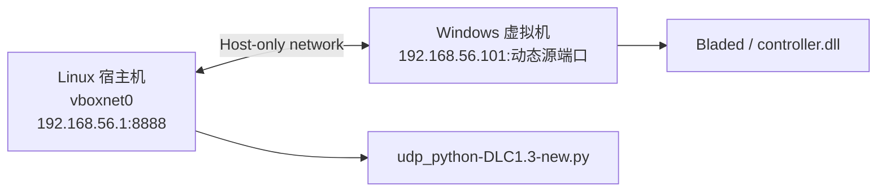

# VirtualBox 离线 Bladed UDP 联通性

本说明用于 Linux 宿主机上的 Python 监听器，与 VirtualBox 内 Windows/Bladed 的外部控制器 DLL 进行双向 UDP 通信。

## 结论

可以在完全不连接 Wi-Fi、网线或互联网的情况下运行。使用 VirtualBox 的 **仅主机网络（Host-only Adapter）** 即可：它是宿主机和虚拟机之间的本地虚拟以太网，不需要物理网络连接。

不要使用 NAT 或桥接网卡作为本次通信链路。若要确保彻底离线，应禁用虚拟机上所有 NAT、桥接和 USB 网卡，只保留一个 Host-only Adapter。

## 当前协议

| 项目 | 值 |
| --- | --- |
| 宿主机监听端点 | Host-only IP，例如 `192.168.56.1:8888` |
| DLL 目标端点 | `BLADED_RL_HOST:BLADED_RL_PORT` |
| canonical 数据 payload | 严格 19 个 SI 浮点字段，顺序为 `BLADED_UDP_VARIABLES` |
| DLL 到 Python wire 帧 | `frame_id,sim_time,<19-field payload>`，共 21 个逗号分隔字段 |
| Python 到 DLL 回复 | `frame_id,torque,pitch` 三个字段，`frame_id` 必须回显 |
| Windows DLL 源端口 | Windows 自动分配的临时 UDP 端口，无需固定 |

`127.0.0.1` 只表示本机回环：在 Windows 虚拟机中的 `127.0.0.1` 指向 Windows 虚拟机本身，不能到达 Linux 宿主机。因此跨虚拟机通信必须使用 Host-only Adapter 的 IP。



示例地址仅用于说明。实际以 `ip`、`VBoxManage` 和 Windows `ipconfig` 的输出为准。

## 1. 建立完全离线的 Host-only 网络

先关闭虚拟机。在 VirtualBox 管理器中执行：

1. 打开 **工具 -> 网络 -> 仅主机网络**，创建或选择一个仅主机网络。
2. 将宿主机侧 IPv4 配为 `192.168.56.1`、掩码为 `255.255.255.0`。
3. 在虚拟机 **设置 -> 网络 -> 适配器 1** 中，选择 **仅主机适配器**，名称选择刚创建的网络，确保“网线已连接”。
4. 禁用其他附加网卡，特别是 NAT 和桥接模式。

在 Linux 宿主机验证该网卡。常见接口名是 `vboxnet0`：

```bash
ip -4 address show vboxnet0
VBoxManage list hostonlyifs
```

如果尚未创建该网络，也可以使用 VirtualBox 命令行：

```bash
VBoxManage hostonlyif create
VBoxManage hostonlyif ipconfig vboxnet0 --ip 192.168.56.1 --netmask 255.255.255.0
```

在 Windows 虚拟机中，为 Host-only 网卡设置静态 IPv4：

```text
IP address: 192.168.56.101
Subnet mask: 255.255.255.0
Default gateway: 留空
DNS server: 留空
```

随后执行：

```powershell
ipconfig
```

确认该网卡显示 `192.168.56.101`。可选地互相 `ping`，但 ICMP 被防火墙拦截并不等于 UDP 不可用，最终判断以本说明的 UDP 双向回包为准。

## 2. 放通仅主机网卡的 UDP 端口

Python 在宿主机接收 UDP `8888`。若 Linux 启用了 UFW，可仅允许 Host-only 网卡上的该端口：

```bash
sudo ufw allow in on vboxnet0 to any port 8888 proto udp
```

Windows 默认允许 DLL 向宿主机发出的 UDP 流量，回复会回到该已建立的临时源端口。若 Windows 有严格的出站策略，可在管理员 PowerShell 中添加只指向宿主机的规则：

```powershell
New-NetFirewallRule -DisplayName 'Bladed UDP host-only' `
  -Direction Outbound -Action Allow -Protocol UDP `
  -RemoteAddress 192.168.56.1 -RemotePort 8888
```

## 3. DLL 部署检查

当前正式源码为 `bladed_env/udptest/udptest/controller.cpp`，DLL 已由用户在 Windows Visual Studio 中生成。本说明不重复 DLL 生成步骤。

只需确认：

1. Bladed 外部控制器配置指向最新生成的 `udptest.dll`。
2. DLL 使用当前 19 列 canonical payload、`frame_id,sim_time` 握手信封和 queue-v2 协议。
3. 不启用 `BLADED_RL_EXPOSE_MX` 时，Python 端按 19 列 payload 校验。

## 4. 启动宿主机通信探测器

在 Linux 宿主机启动监听器。初次验收使用 `--reply-current-action`：它把 DLL 帧中的 `O_PcsTorqueDemand`、`O_PitchPositionDemand1` 槽位与同一 `frame_id` 原样回复，形成保持当前动作的闭环，仅用于验证通信，不是 RL 推理。当前 DLL 源码在发送前以实测 `I_ElectricalTorque`、`I_PitchPosition1` 填充这两个槽位，因此该模式验证的是网络与回复链路，不是 Bladed 内部 PID demand getter。

```bash
cd '/home/zhongyuanai/桌面/lyq/Wind_trubine/code/wind_trubine'

/home/zhongyuanai/miniconda3/bin/conda run -n wind python -u \
  bladed_env/udp_python-DLC1.3-new.py \
  --bind-host 192.168.56.1 \
  --port 8888 \
  --reply-current-action \
  --max-packets 3 \
  --output-dir bladed-data-new/raw/udp_connectivity_test
```

若宿主机实际 Host-only 地址不同，替换 `192.168.56.1`。也可以临时使用 `--bind-host 0.0.0.0` 监听所有本地网卡；验收完成后建议绑定到 Host-only IP。

## 5. 设置环境变量并手动启动 Bladed

Bladed 只能手动点击桌面/开始菜单图标启动，不能在命令行调用 `Bladed.exe`。为保证手动点击启动的进程读取到 DLL 配置，在 Windows PowerShell 中将通用参数写入 User 环境变量：

```powershell
$userVariables = @{
  BLADED_RL_HOST = '192.168.56.1'
  BLADED_RL_PORT = '8888'
  BLADED_RL_TIMEOUT_MS = '1000'
  BLADED_RL_UDP_PROTOCOL = 'bladed_udp_19_si_my_queue_v2'
  BLADED_RL_POST_LOAD_DISCARD_SIM_S = '0'
  BLADED_RL_EXPOSE_MX = '0'
}
foreach ($item in $userVariables.GetEnumerator()) {
  [Environment]::SetEnvironmentVariable($item.Key, $item.Value, 'User')
}
```

实验 profile、round、train time 和 `BLADED_RL_MANUAL_BATCH_RUN_ID` 也必须写入 User 环境变量。注销并重新登录 Windows，或重启 Windows Explorer 后，手动点击 Bladed 图标并运行正确工程。

初次测试建议 `BLADED_RL_TIMEOUT_MS=1000`，便于观察和排障。它只约束 DLL 发送当前帧后等待对应动作回包的墙钟时间，不等于 Bladed 的 $20\ \mathrm{ms}$ 物理仿真步长；应根据实际 Host-only 网络、Python 推理和安全投影的最坏延迟设置，不能仅因仿真步长为 $20\ \mathrm{ms}$ 就降低到 `20` ms。

初次测试建议 `BLADED_RL_TIMEOUT_MS=1000`，便于观察和排障。它只约束 DLL 发送当前帧后等待对应动作回包的墙钟时间，不等于 Bladed 的 $20\ \mathrm{ms}$ 物理仿真步长；应根据实际 Host-only 网络、Python 推理和安全投影的最坏延迟设置，不能仅因仿真步长为 $20\ \mathrm{ms}$ 就降低到 `20` ms。

Bladed 只有在：

```text
GetSimulationCurrentTime(turbine_id) >= GetSettlingTime(turbine_id)
```

后才发送 UDP 帧。因此启动仿真后需要越过 settling time 才能看到第一帧。

## 6. 成功判据

宿主机应显示类似输出：

```text
Listening on UDP 192.168.56.1:8888; expected payload fields=19; require_frame_id=True; reply_current_action=True
frame=1 peer=192.168.56.101:5xxxx sim_time=... payload_time=... | torque=... | pitch=...
Replied hold action for frame 1 to 192.168.56.101:5xxxx
```

其中 `5xxxx` 是 Windows 自动分配的源端口，每次启动可不同，属于正常现象。日志出现相同的 `frame` ID、`Replied hold action for frame`，同时 Bladed/DLL 侧没有接收超时，即表示 IP、端口、19 列业务数据和反向 UDP 路径均已完成一次完整帧握手。输出目录还会生成一份含表头和数据行的 `turbine_compact_*.csv`；其中任一有效功率字段会被同步写入 `Electrical power` 和 `I_RealPower` 两列。

## 7. 帧握手与风况切换

一次 RL transition 不是按固定墙钟 $20\ \mathrm{ms}$ 判定成功，而是按以下序列判定：

1. DLL 发送 $F_k=(id_k, t_k, x_k)$，其中 $x_k$ 是 19 列 canonical payload。
2. Python 校验 payload、计算安全动作，并回复 $A_k=(id_k, torque_k, pitch_k)$。
3. DLL 只接受 `id_k` 匹配且数值有限的回包，随后应用动作；错帧或延迟回包会被丢弃并保持实测动作。
4. RL 环境收到 $id_{k+1}>id_k$ 的下一有效状态帧后，才记录 $(x_k,A_k,x_{k+1})$ 为完成的 transition。

活动训练配置启用了 `udp_require_frame_id=true`、`udp_inter_frame_wait_s=600` 和 `udp_pause_threshold_s=2`。Bladed 在切换风况时不发送状态帧，Python 会在已发送动作后最多等待 600 秒；若下一帧在此上限内到达，日志中 `udp_handshake_complete=1`，等待超过 2 秒时还会记录 `udp_pause_active=1`，不会写入伪造 reward 或结束 episode。只有超过 600 秒仍没有新帧时，环境才产生 `udp_inter_frame_timeout=1` 的无效 terminal transition；replay filter 会排除它，下一次 `reset()` 再等待新的状态帧。

`bladed_step_duration_ms=20` 仅保留为逻辑仿真步长记录。正式配置将 `wall_clock_step_deadline_ms=0`，因此风况切换的墙钟等待不会被统计为 $20\ \mathrm{ms}$ deadline overrun；若需要部署级性能 SLA，应单独设置一个现实可达的墙钟上限。

## 8. 故障定位

| 现象 | 原因与处理 |
| --- | --- |
| 宿主机没有任何帧 | 检查虚拟机网卡是否为 Host-only、Windows IP 是否同网段、DLL 是否从设置了 `BLADED_RL_HOST` 的进程启动，以及仿真是否已越过 settling time。 |
| Python 报告缺少 formal frame envelope 或收到 19 个裸字段 | Bladed 仍加载旧 DLL，重新在 Windows 编译并确认替换的是实际被 Bladed 引用的 DLL。 |
| Python 显示帧和 `Replied hold action for frame`，DLL 仍超时 | 检查 Windows 防火墙策略、`BLADED_RL_HOST` 是否为宿主机 Host-only IP，以及 DLL 日志中的发送/接收 `frame` ID 是否相同。 |
| 训练显示 `udp_inter_frame_timeout=1` | 先确认 Bladed 是否仍在切换风况；若切换正常但超过 600 秒，按实测最长切换时间提高 `udp_inter_frame_wait_s`，不要降低 DLL 动作回包 timeout。 |
| Python 无法绑定 `192.168.56.1:8888` | Host-only 网卡/IP 未创建，或端口被旧监听器占用。检查 `ip -4 address` 和 `ss -ulnp | grep 8888`。 |
| DLL 目标仍为 `127.0.0.1` | 这是 Windows 虚拟机自身，不是宿主机；改用 Host-only IP。 |

完成本验收后，将 Python 端切换为实际的 RL 环境或推理入口即可；它们同样使用 `frame_id,sim_time,<19 列 payload>` 输入帧和 `frame_id,torque,pitch` 回复格式。